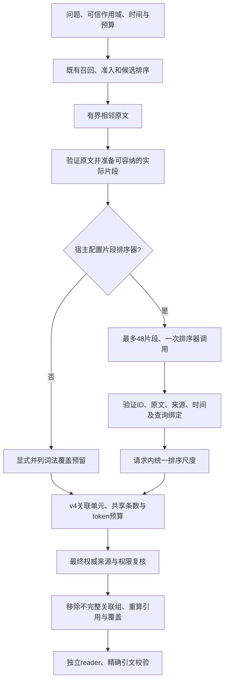

# V5：多主题分配与实际片段排序（2026-10-17）

V5 是显式启用的实验策略，默认继续使用 v2。它沿用 v4 的事实独立性、原文定位和最终权限检查，补充两个可组合的机制：显式并列问题的词法分配，以及宿主可选的实际片段排序。没有按 benchmark 题号、商品、金额或职业写入规则。

## 架构与数据流



核心职责保持明确：

| 模块 | 职责 |
| --- | --- |
| `coverage_plan.py` | 只生成请求内词法分组和覆盖诊断 |
| `passage_reranking.py` | 选择实际表示、调用宿主排序器、校验返回顺序及原文绑定 |
| `packing.py` | 在共享预算内选择片段和 v4 关联单元 |
| `delivery_guard.py` | 最终治理后删除失效证据并重算覆盖 |
| `examples/memory_passage_reranker.py` | 可复用提示词与严格 JSON 解析，无网络或密钥处理 |
| 宿主 | 模型、网络、隐私边界、累计计费和调用次数控制 |

## 无模型词法分配

1. 仅在不超过4096字符的请求里识别明确并列分隔；保护引号和括号，最多4组。
2. 对空组、数字组、无法区分的组或以从属代词开始的后续分句放弃预留。
3. 使用现有内容词分析器生成各组独有词，在已召回候选里选稀有出现词作为分配锚点。它不产生新事实或新召回。
4. 预算可行时给尚未覆盖的组分配片段，再继续普通 v4 选择。组名命中只是词法存在；`answer_completeness_verified=False`、`world_negative=False` 始终保留。
5. 最终治理删除证据后，从实际送达文本重新计算覆盖。

该机制恢复了既有人工压力集的三个多主题遗漏，但真实购物题仍会把泛泛讨论里的 `designer` 当作覆盖。这说明词法主题命中不能证明支持答案。因此没有继续为该题调词权重；启用实际片段排序后，排序结果接管选择，词法分组只保留诊断。

## 实际片段排序

每个直接候选至多准备一种实际表示。优先选择不超过 `token_budget / limit` 的最大合法原文窗口；否则选整个请求预算可容纳的最小窗口。Claim 不截短，继承上下文不独立送排。最多48项、一次 `Reranker.rerank` 调用；空输入不调用。

排序器收到临时ID和实际文本。返回必须覆盖整个提交集合，不得新增、重复、修改原文、来源、定位、类型或时间。查询绑定包括作用域、有效时间、感知时间及预算。校验后只采纳顺序，不采纳提供方替换的证据对象。异步期间的删除仍由最后的权威检查执行。

同次调用内使用统一序数尺度；未送排的候选留在尾部，避免把不同来源的原始分数混用。已送排的片段锁定到原文证明，打包器不能再次裁切后沿用该分数。依赖上下文继续采用 v4 的锚点边界，不声称它经过独立语义排序。

片段分数只表示排序意见。`relevance_basis=reranked_passage` 证明评分绑定到该文本，不证明事实蕴含、回答完整或用户身份。全局 `packing_passage_relevance_verified` 仍为 false。

### 生成式排序的两种协议

`GeneratedPassageReranker` 的默认协议 `generated-permutation/1` 要求完整排列，遗漏即失败。可显式设置 `allow_unranked_tail=True`，选择 `generated-partial-order/2`：

- 只接受非空、无重复、全部来自输入的ID子集。
- 被遗漏项按原输入顺序追加为未评分尾部；不丢弃，也不补造模型评分。
- 诊断区分提交数、评分数、提供方遗漏数和全部未评分尾部数。
- 选中遗漏项时追踪为 `unranked_passage`；重复、未知ID、改写证据、非有限分数或提供方异常仍失败。
- 没有自动重试或隐式切换检索路径。严格失败必须保留，采用新协议得到的结果另行登记。

核心对现有 `EmbeddingReranker` 的兼容通过确定性向量夹具验证；本轮真实实验使用生成式排序，并没有真实 embedding 服务实验。

## 配置

```python
from agent_memory import build_local_kernel
from agent_memory.retrieval.passage_reranking import GeneratedPassageReranker

# 纯本地词法分配，不新增模型调用。
kernel = build_local_kernel("memory.sqlite3", packing_version="v5")

# generator 由可信宿主实现 async rank_passages(query, records)。
# 网络、模型选择、单次上限和累计账本都在宿主。
provider = GeneratedPassageReranker(generator, allow_unranked_tail=True)
kernel = build_local_kernel(
    "memory.sqlite3", packing_version="v5", passage_reranker=provider,
)
```

PostgreSQL 构造器接受同样参数。只有显式 v5 可以配置 `passage_reranker`。评测 CLI 支持 `--packing-version v5`，但该参数本身不会启用远程模型排序。现有 Reranker 也可作为宿主注入的实现。

## 验证结果

| 既有24条人工开发案例：关键证据完整送达 | reader v2 | reader v3 |
| --- | ---: | ---: |
| v2 | 21/24 | 21/24 |
| v3 | 12/24 | 12/24 |
| v4 | 21/24 | 21/24 |
| v5，仅词法分配 | 24/24 | 24/24 |

这些是已暴露且相关的开发案例，衡量证据送达，不是模型准确率。14个既有真实历史的副本回放没有重新抽取或改动权威证据。词法 v5 的购物题仍缺少一个金额。

随后在3个已暴露开发样本上运行 DeepSeek-V4.1-Flash 实际片段排序：前两个返回完整排列；第三个48项中仅返回47个合法ID，原严格协议停止，原失败记录保留。新增部分排序协议后，逐字核对输入并复用全部3个冻结响应，没有重发排序请求。两项购物金额均进入上下文。

同一 DeepSeek 模型回答、Qwen3.8-Max-0902 按已固定的上游 rubric 独立评分，结果 **3/3**。回答先冻结，再开放 gold。职业题、日期差控制题、购物合计题均通过引文协议校验。原 v3r3 曾在这3题上同样达到3/3，所以这次结果不证明优于 v3，也不能替代未见样本检验。原始成绩、严格失败和派生成绩分别保留。

本轮合计新增9次付费调用（3排序、3回答、3评分），估计费用 **0.070768元**；累计计费和历史未知用量保留额度 **3.3989341元**，20元上限剩余 **16.6010659元**。没有重新抽取。计价是账本费率估计，不是服务商账单。

最终局部回归 **647通过、173跳过、0失败**，没有运行全仓库或完整 LongMemEval。224组固定/随机候选差分对照确认默认/显式v2、显式v3和v4的选中原文、引用和预算保持一致。未配置的 PostgreSQL 和可选数据项跳过；没有由此声称在线PG验收完成。

## 未完成的验收

- 不参与调试的冻结开发样本及最终 holdout，按题型、证据完整性、误答和弃答分别验收。
- 同一记忆、reader与模型下的 v2/v4/v5 对照；本轮3题不足以归因或推断总体准确率。
- 真实 embedding/cross-encoder 与生成式排序的成本、额外延迟和质量对比。
- 更广的语义候选发现。已召回集合之外的事实、未选原文窗口和48项之外的候选仍可能遗漏。
- 词法分组不具备通用语义分解能力；单一窗口、邻居顺序和预算也不保证完整支持。

所有产物保存在独立的 `acceptance-reports/coverage-passages-v5-20261017/`，包括严格失败、冻结响应、新协议、回答冻结、评分和继承账本。代码继续保留实验开关。
