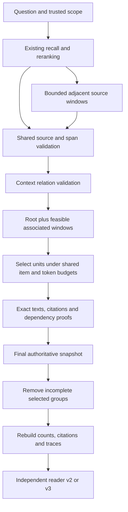

# V4 evidence units — 2026-10-16

## Status and scope

V4 is an explicit experimental packing policy. **V2 remains the default.**
V3 and its results remain available for comparison. This step implements
conservative fact handling and source-context association; it does not establish
benchmark answer accuracy or solve general candidate coverage.

V4 removes topic-word repetition penalties and length-based relevance discounts.
Separate purchases, updates and contradictions stay independent candidates.
Deduplication is limited to existing exact candidate identities and verified raw
source coverage. Matching text, source, topic or predicate alone does not prove
that two factual events are the same.

## Architecture and data flow



- `packing_policy.py`: frozen policy selection, with no v4 topic/cost weights.
- `evidence_units.py`: pure source relation validation and exact dependency proofs.
- `packing.py`: existing candidate preparation, shared limits, unit selection and
  final source proofs. It invokes no models.
- `delivery_guard.py`: current authorization and source checks, then removal-only
  dependency closure. It never restores a member that failed authorization.
- `packing_ablation.py`: manifest-defined packing policies crossed with two
  reader formats. Historical four-arm manifests remain interpretable.

## Relation and selection algorithm

1. Treat an item as inherited context only when the host supplied `context_only`
   and the inherited-anchor marker. Resolve the anchor through its candidate ID.
2. Require located EVENT windows, one source ID equal to their shared public
   event ID, the same source revision/length, a direct non-context anchor, and
   touching or overlapping source intervals. Overlapping characters must agree.
   These checks constrain allocation; authoritative repository checks still own
   source access and erasure.
3. Exclude context-provided scores from relevance normalization. A valid child
   uses its anchor's allocation bound. Invalid and orphan context cannot compete
   independently or inflate the score scale.
4. Select a root with its largest feasible association in provider order. If
   all neighbors do not fit, try complete root/neighbor pairs; finally allow the
   root alone. Count every selected text against item/token limits. Report
   deferred context instead of emitting an unanchored fragment.
5. Score roots using the baseline relevance-led ordering. Association members do
   not add artificial query coverage to a root's score. A selected group retains
   individual exact text/citations plus a group proof over candidate IDs, text
   hashes, revisions, source IDs and actual spans.
6. At final delivery, first apply the current authority snapshot. Remove every
   incomplete selected group, including transitively overlapping groups. An
   ungrouped context-only item is removed. Recalculate delivered citations,
   counts and token estimates. JSON array/tuple normalization does not weaken
   exact proof matching.

Adjacency is an optional source association, not proof of a linguistic or causal
dependency. Provider order cannot determine which of two neighbors contains the
answer when only one fits. V4 records that incompleteness and remains experimental.

## Narrowed passage relevance

V4 uses the existing content-anchor analyzer when locating excerpts, so function
words alone do not pull a window toward repetitive background. It does not
multiply semantic relevance by retained text length. A narrowed representation
records `relevance_basis=unverified_parent_bound`; inherited context records
`inherited_anchor_bound`. `packing_passage_relevance_verified` remains false.

These bounds are allocation hints. The shortened text has not received a new
semantic score. A semantic-only answer late in a large source can still be
missed, and raw source limits still apply. Configurable passage reranking and
coverage planning remain subsequent work requiring cost/quality validation.

## Validation and limits

The frozen development matrix uses the previous 24 authored stress cases:

| Packing | Reader v2: complete evidence | Reader v3: complete evidence |
| --- | ---: | ---: |
| v2 | 21/24 | 21/24 |
| v3 | 12/24 | 12/24 |
| v4 | 21/24 | 21/24 |

V4 passes the no-new-evidence-loss gate relative to v2 on these cases. The three
distinct-topic coverage cases remain incomplete. These correlated cases are
already exposed development regressions, not an unseen benchmark accuracy test.

Focused tests add competing independent events, corrections, English/Chinese
topics, low-scored inherited context, infeasible groups, invalid source links,
inconsistent overlap, dependency loss at final authority filtering, transitively
overlapping groups and JSON proof round trips. Temporal, tenant and erasure
checks also run with v4.

Fourteen already completed real-data histories were replayed from copied closed
SQLite databases with their evidence fingerprints checked before and after.
No extraction, answers or judgments were generated. The occupation fact reaches
the reader, while the two-purchase case still lacks the $800 operand. No new
14-case answer accuracy or complete manual fact-recall score is claimed.

Differential checks preserve v2/default and v3 selections on 224 fixed/randomized
candidate pools. Original datasets, results, frozen runtime copies and API
accounting remain unchanged. New model requests and incremental API cost are zero.

## Configuration

```python
kernel = build_local_kernel("memory.sqlite3", packing_version="v4")
```

PostgreSQL accepts the same option. The HTTPS, local smoke and full-comparison
runners accept `--packing-version v4` independently of reader selection. For an
offline matrix, use new output directories and explicit versions:

```sh
PYTHONPATH=src:. python -m experiments.public_longmemeval.packing_ablation freeze \
  --inputs /absolute/path/blind.jsonl --output /absolute/path/new-run \
  --packing-versions v2 v3 v4
PYTHONPATH=src:. python -m experiments.public_longmemeval.packing_ablation evaluate \
  --requirements /absolute/path/requirements.evaluator-only.jsonl \
  --output /absolute/path/new-run --candidate-version v4 --require-no-regression
```

Final focused checks: **616 passed, 173 skipped, 0 failed**. Environment and
optional-data skips are separate from passes. The new evidence-unit module has
77/77 executable lines exercised by stdlib tracing; branch coverage was not
measured. The whole repository suite and live PostgreSQL behavior were not
retested. The final JSON proof compatibility repair was validated locally after
the recorded real-data replay; that replay keeps its original source snapshot.
