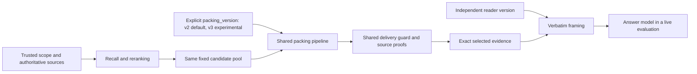

# Packing generalization audit — 2026-10-15

The subsequent [v4 evidence-unit implementation](BENCHMARK_EVIDENCE_UNITS_V4.md)
addresses conservative fact handling and source-context association. It remains
experimental, and the v2 default and historical v3 audit below remain in force.

## Decision

Keep stable **v2 packing as the default**. Keep v3r3 available only by explicit
opt-in. Its development-case improvement does not establish general retrieval
quality. The new competition tests expose real necessary-evidence losses, so
v3 fails the no-new-evidence-loss gate. Parameters were not adjusted to make
these new tests pass.

Source-span validation, final permission/deletion checks, citation binding and
verbatim reader delivery remain shared correctness boundaries. Lexical support
discounting, topic novelty/repetition, inherited-context discounting and cost
selection remain experimental allocation heuristics.

## Architecture



`retrieval/packing_policy.py` contains frozen policy parameters and returns an
independent serializable contract. `packing.py` uses the same source preparation,
item/token bounds and final proof assembly for both versions. The kernel,
SQLite builder and PostgreSQL builder accept `packing_version="v2"|"v3"`;
unsupported versions fail before retrieval/model work. Every native bundle
records `packing_contract` and `strategy`, including empty results.

The HTTPS, Mac smoke and full-comparison CLI expose `--packing-version` with
default v2. Reader v3 can be used with packing v2. Packing v3 can be used with
reader v2. CLI reader defaults and existing callable reader defaults remain
documented separately; there is no implicit coupling between them.

## Evaluation protocol

`experiments/public_longmemeval/packing_ablation.py` freezes four arms:

| Packing | Reader |
| --- | --- |
| v2 | v2 |
| v2 | v3 |
| v3 | v2 |
| v3 | v3 |

All arms receive identical supplied, already ranked candidates, item limits and
content-token budgets. Native packing runs once per packing policy. Both readers
then serialize its exact selected texts; they cannot repair a missing fact.
Frozen outputs, input/runtime hashes and policy contracts precede opening a
separate evaluator-only requirements file. Outputs and evaluations refuse
overwrites. An optional `--require-no-regression` gate preserves its failed
report and exits 2 when v3 loses a requirement delivered by v2.

These are **risk-driven authored synthetic challenges**, not held-out LongMemEval
samples. There are eight scenario families at 64/128/256 estimated tokens, giving
24 correlated cases. Each includes 12 background distractors plus competing
topical candidates. Synonym cases have only one slot; conflict/bridge cases two;
counting has three; multi-topic coverage has four. Requirements identify exact
necessary text in a particular memory; source-session hits alone cannot pass.

The first audit had two slots in the synonym cases. They could admit both the
answer and its topical competitor. A second fixture version strengthened those
cases to one slot. Both rounds are preserved; no algorithm parameters changed
between them. This fixture development makes a statistical generalization claim
especially inappropriate.

## Final challenge results

| Scenario family | v2 complete / 3 | v3 complete / 3 |
| --- | ---: | ---: |
| English synonym, cropped source, competing topical text | 3 | 0 |
| Conflicting permission and revocation | 3 | 0 |
| Cross-turn pronoun/answer bridge | 3 | 0 |
| Three separate purchases on one topic | 3 | 0 |
| Chinese synonym | 3 | 3 |
| Distinct-topic coverage | 0 | 3 |
| Speaker role and hypothetical negation | 3 | 3 |
| Updated numeric value | 3 | 3 |
| **Complete required evidence** | **21 / 24** | **12 / 24** |

V2 delivered 33/36 required text spans; v3 delivered 24/36. V3 improved three
cases and regressed twelve. Reader v2/v3 give identical evidence-delivery counts
for the same packer. This is an offline **packing/framing** ablation, not a live
answer-model ablation. No new answer accuracy, false-acceptance rate, extraction
quality, candidate-recall quality or provider latency was measured.

The failure mechanisms match the audit risks: length-based discounting can
underrate a useful semantic excerpt; query-word repetition can penalize different
events or contradictory facts; inherited-context discounting can displace the
only adjacent answer. The multi-topic improvement is real within this fixture
set, but does not compensate for those correctness losses in other families.

Reader v3 adds source framing. Final total serialized-context estimates are
1813/6418 tokens with packing v2 and readers v2/v3, and 1596/6077 with packing v3.
These are heuristic context estimates excluding full answer prompts and output,
not provider token bills or evidence of total-cost savings.

## Compatibility and remaining work

Differential checks compare defaults and explicit v2 against frozen commit
`0b85577173234fb81e38c35cb625a2e13b4ef7ed`, and explicit v3 against the frozen
v3r3 source. They compare delivered evidence, source metadata/citations, token
costs and coverage counts. New contracts/traces may contain additional diagnostic
fields. The original scores, frozen databases and API ledger are preserved.

Future algorithm work should assess source-bound fact/event identity rather
than query-word overlap, preserve explicit context dependencies as a unit, and
validate the actual narrowed passage with a relevance mechanism suited to the
configured retriever. Those mechanisms are not implemented by this audit.
Freeze any replacement policy before testing unseen benchmark samples, and run
the live 2x2 answer/judge experiment separately with the same memories, generation
models, rubric and cumulative budget. Passing this synthetic gate alone would
still not establish production readiness.

## Reproduce the offline audit

Use new output directories; existing artifacts are immutable.

```sh
PYTHONPATH=src:. python -m experiments.public_longmemeval.packing_ablation freeze \
  --inputs /absolute/path/blind.jsonl --output /absolute/path/new-run
PYTHONPATH=src:. python -m experiments.public_longmemeval.packing_ablation evaluate \
  --requirements /absolute/path/requirements.evaluator-only.jsonl \
  --output /absolute/path/new-run --require-no-regression
```

Blind JSONL rows contain case ID, question, fixed candidates, token budget and item
limit; candidates include ID, kind, text, score, occurred_at and source metadata.
Evaluator rows separately contain case ID, category and nonempty required text
spans bound to memory IDs. The fixture generator is in
`experiments/public_longmemeval/tests/packing_fixtures.py`.

## Validation record

Focused repository checks: **588 passed, 173 skipped, 0 failed**. Skips require
PostgreSQL DSNs or optional public data. The whole repository suite was not run.
PostgreSQL constructors also passed a no-connection configuration smoke check.
224 differential cases per version preserve frozen v2/default and frozen v3r3
selection semantics. Original, v2 and completed v3 artifacts passed hash checks.
No new API requests were made; cumulative charged/reserved cost remains
3.3281661 CNY. These engineering checks do not override the rejected v3
evidence-delivery acceptance gate.
