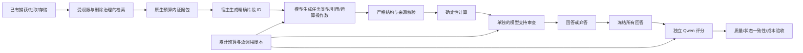
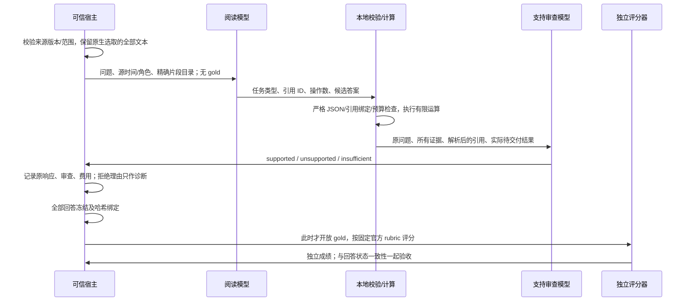

# 通用问答可靠性与质量/成本验收补充设计

日期：2026-10-20。整体架构仍为 v7.2；本文的 reader v4 / 协议修订 4.1 指问答实验协议，与 packing v5、整体架构版本分开。

2026-10-21 的修复见 [协议修订 4.2](BENCHMARK_QA_RELIABILITY_V4_2.md)。本文表格保留 4.0/4.1 的原实验结果。

**工程实现完成；完整质量及成本验收未通过。** 默认 reader v3、packing v2 不变。新版通过 `--reader-version v4` 显式选择，不能因小规模诊断有改善就提升为默认。

## 架构与责任

核心 `retrieval/answer_computation.py` 只计算，不调用模型、不读取 gold、不写记忆。`examples/memory_evidence_reader_v4.py` 负责有限问答协议；公共评测入口与回放器位于 `experiments/public_longmemeval/`；`evaluation/public_qa_acceptance.py` 复用既有 CostSnapshot，生产核心不依赖评测。

“引用可追踪”“运算正确”“模型认为语义支持”“真实业务权威核验”是不同结论。模型审查仍可能错误，所有结果都保持 `entailment_verified=False`，不会直接成为已核验记忆。

## 数据流及算法

1. **精确片段引用**：宿主将选定文本连续划分为不超过 160 UTF-8 字节的片段，保留全部字符和空白；模型选择片段 ID。校验器解析成原文与精确字符起点，拒绝未知 ID。保留旧式短引文兼容；引文不存在、越界或超预算时记协议错误，不自动修补或裁剪。
2. **任务区分**：事实问答只依据证据；建议任务允许组合通用想法，但用户的事实与偏好必须有依据，并标记为建议。历史指令始终是数据。
3. **有限运算**：日期先后、经过天数、日历月差、去重计数、十进制求和与相减。日期/数值允许显式区间；重叠时不伪造确定顺序；天数同时说明经过时长和含首尾日的口径。
4. **相对时间**：不同证据必须由宿主元数据证明共享来源的本地日期与时区偏移，才能比较同单位的有符号偏移。结果显式为近似先后；数值解释仍需模型审查。缺少锚点或锚点不一致时拒绝该运算，不能只因 UTC 日期相同就合并。
5. **状态与计数**：区分来源直接报告的总数、较晚的状态更新与临时召回组成的枚举。有限召回的枚举计数只能输出下界；不能由模型声明集合完整。完整计数仍需可信宿主提供受范围及版本绑定的穷尽查询路径。
6. **单独调用审查**：审查所问关系、事件、角色、计划/实际、时间、单位及操作数。审查的是本地计算后的待交付答案，保留被替换的原草稿作诊断。最多两次生成调用；异常不重试，不以换写输入绕过服务商拒绝。
7. **弃答隔离**：用户答案只输出 `I don't know.`，具体拒绝理由保留在诊断。防止包含正确事实的拒绝理由被评分器误当成有效作答。

## 验收口径

- 固定计划分母；未启动、未评分、协议错误和服务商拒绝分开报告。500 题未全部评分时完整集准确率为 null。
- 同时记录官方 rubric 分数与严格有效正确数：严格口径还要求作答/弃答状态与 gold 可回答性一致。不能用“评分 yes”掩盖错误弃答。
- 回归数据已被开发者查看，不能标为独立 holdout。问题类型、gold、旧答案和错误标签不进入生成输入。
- 每次草稿、审查、评分均计费；失败和未知用量保留预算；待执行责任计入上界。缓存、复用的抽取与排序不意味着历史费用归零。
- 费用账本复用既有全成本类型。仅测前台 API 的实验不能通过端到端成本验收；CPU/I/O/存储及后台阶段未知时保留缺口。
- 80% 正确率和 2% 技术失败率是当前工程检查默认值，未做真实业务校准，不能作为业务发布标准。

## 本轮真实验证

冻结原 v5 证据，不重新抽取、排序或改写旧成绩。模型仍为 DeepSeek-V4.1-Flash 生成与审查，Qwen3.8-Max-0902 独立评分，关闭 thinking；累计费用上限仍为 20 元。

| 阶段 | 范围 | 官方评分 | 严格有效正确 | 解释 |
| --- | --- | --- | --- | --- |
| reader v4 首轮 | 原 27 个有完整证据的案例，26 个可评分 | 20/26；旧版 17/26 | 15/26 | 发现过度弃答和拒绝理由泄漏；不能视为成功验收 |
| 协议修订 4.1 | 6 个有意选择的开发诊断案例 | 5/6 | 5/6 | 修复最新状态、算术回归、引用、时长和先后；非总体准确率 |

两段新增费用合计 0.713252 元；累计 19.9111621 元，剩余 0.0888379 元。既往未知用量保留 0.1524528 元未冲销。费率估算不等于账单，不宣称总成本下降。

费率核对：[DeepSeek 百炼北京模型信息](https://help.aliyun.com/zh/model-studio/deepseek-v4-1-flash)、[百炼模型价格](https://help.aliyun.com/zh/model-studio/model-pricing)。采用输入/输出 2/8、12/36 元每百万 token，忽略缓存折扣。

## 尚未通过的部分

月级时间题仍有过度弃答；开放集合召回不完整；来源粒度、隐含日期、跨事件歧义和模型支持审查仍可能出错。修订 4.1 没有预算覆盖原 26 题全部回归，更没有完成 500 题独立实验。公共历史 QA 也不能替代真实业务原文→权威核验→项目视图的 LIFE-07 验收。

保持新协议显式启用。继续开发应补齐时间粒度/不确定性政策、完整计数的受治理查询、固定开发集和未接触的独立验收集；使用独立预算完成全链路质量、成本及性能对照后，才能考虑提升默认版本。
