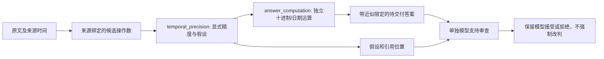

# 问答可靠性协议修订 4.2

2026-10-21。这是 reader v4 的实验协议修订，上位架构仍为 v7.2，reader v3 默认不变。旧协议、模型成绩和预算账本保留。

## 已修复的问题

| 问题 | 修复 | 验证边界 |
| --- | --- | --- |
| 计算覆盖掉“约几个月”和来源月份假设 | 日期区间结果保留近似限定；源月份代理作为结构化假设进入计算、核验输入及交付文本 | 确定性数据流修复；没有重新调用真实模型 |
| 十进制受调用者全局 context 影响、极限求和舍入 | 使用独立 64 位十进制 context，支持规定的 32 个操作数及 12 位小数 | 检查低精度/异常陷阱不影响结果，也不修改调用方设置 |
| 日/月操作忽略冲突单位 | 拒绝与运算类型冲突的单位 | 不把月份当作天数执行 |
| 不同原文位置的相同文本被当成重复引文 | 以 evidence ID、字符位置及文本判重；保留位置给审查模型 | 同一位置的重复引用仍拒绝；重复文本不因此成为独立事实 |
| 片段边界导致近期报告无法识别 | 仅拼接同一证据中相邻/重叠的已引用字符区间 | 不跨来源或未引用间隙拼接 |
| 技术失败率被未启动题目稀释 | 用已记录的尝试结果作为分母，同时保留计划分母和未完成统计 | 原首轮为 1/27，而不是 1/500 |
| 官方 yes 掩盖错误弃答 | 错误弃答同时按 gold 可回答性统计，不依赖官方 yes/no 单一标记 | 官方分数与严格状态一致性指标分别保留 |
| 未知用量被较小估计释放预留 | 未知用量保留较大预算责任；没有有限预留就保留未知 | 不修改实际账本、不冲销历史费用 |
| 待执行责任未进入分阶段合计、费用可归属其他工作量 | 阶段合计纳入待执行费用，拒绝工作量之外的请求 ID | 空归属的公共成本继续按原规则保留 |
| 评分摘要可与原始 yes/no 不一致 | 校验原始裁判输出、逐题判定、完成摘要的一致性；金额用整数向上换算 | 新报告写入 V3 文件或独立目录，不覆盖 V2 |
| 新依赖未进入冻结运行时 | 后续实验快照包含 temporal_precision.py | 不追改旧运行时清单 |

## 时间精度契约



源月份代理仅用于 `elapsed_months`：候选必须给出完整来源月区间，引用中有近期第一人称完成报告，来源是原文事件、具有可用的本地日期/偏移，且不与明确日期冲突。派生摘要、已知 assistant 独立发言、无时区、不同来源锚点或错误月份不能由模型自称为有效代理。

这仍是明确的近似假设，不证明实际事件一定发生在该月。核验器必须继续核对角色、事件和关系，`entailment_verified` 保持 false。严格场景可在 Python 调用中设置 `allow_source_month_proxy=False`；该设置同时进入请求和校验，不能靠提示词默许绕过。

旧候选兼容识别只检查有限的日期、引文及来源条件，不读取问题 ID、标准答案或旧评分。中英文、常用缩写、闰月、跨年和本地月边界均有定向测试。

## 冻结数据验证

对旧首轮 27 份候选和修订 4.1 的 6 份候选做离线校验重放，共 33 份；不重新抽取、排序、回答或调用评分器。

原失败月级时间候选从 `6 calendar months.` 变为带来源月份代理说明的 `Approximately 6 calendar months, using the source report month as an approximate event month.`。这是候选数据流正确性的证据；旧模型拒绝结果保留，没有把它算作新的正确答案。

新增离线命令：

```bash
python -m experiments.public_longmemeval.replay_qa --offline \
  --source /absolute/path/to/frozen-replay \
  --output /absolute/path/to/new-output
```

先核对冻结清单、请求、来源及回答哈希；拒绝覆盖已有输出。结果的 `paid_calls=0`、`gold_opened=false`、`new_accuracy=null`。

新统计报告可用 `qa_report SOURCE --destination NEW_DIRECTORY` 生成。官方成绩保持原值，新增统计不会冒充模型重测或全量准确率。

累计费用仍为 19.9111621 元，剩余 0.0888379 元；本轮新增 API 调用及费用均为零。

## 仍然未完成

真实模型是否因此减少月级时间误拒绝，尚未付费复测。开放集合的完整召回、修订后的完整开发集回归、独立全量质量/成本及真实业务 LIFE-07 仍未通过，不能将协议修复标为整体验收通过。
