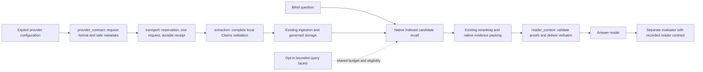

# Benchmark reliability v2 — 2026-10-14

Status: provider contracts and native reader delivery implemented; candidate
expansion implemented as an **opt-in experiment**, not accepted for default use.
This version changes the reader protocol. Frozen checkpoints, scores, accounting
and source snapshots from earlier runs must remain separate.

## Module boundaries

- `provider_contract.py` is pure: no credentials, I/O, retries, model routing or
  budget changes. `json_object` includes the original schema in the prompt;
  `json_schema` sends the explicit strict-schema request. Selection is configured,
  never guessed from the model name or changed after failure.
- `extraction.py` rejects missing/extra/duplicate fields, invalid confidence,
  nonfinite numbers, blank strings and more than eight claims. Malformed output
  cannot silently become a successful empty extraction.
- `transport.py` separates HTTP outcome, usage status and cost basis. Safe
  request IDs and error codes survive failures; unknown usage retains the full
  reservation. A failed response does not automatically retry or clear a halt.
- `reader_context.py` validates ordered occurrence identities, citation sources
  and spans before delivering all selected text. The existing native packer
  owns the 2048-estimated-token/eight-item budget. There is no second truncation.
  A serialization guard includes framing and fails explicitly on overflow.
- Both HTTPS and local runners use this reader contract. Raw baselines retain
  the named legacy 6000-byte prefix contract, so these are not equal-budget
  comparisons. Evaluator summaries carry that limitation; old results without a
  contract remain `unknown`, not retroactively assigned the new protocol.

## Experimental candidate recall

`build_local_kernel(..., enable_query_facets=True)` or
`SQLiteMemoryRepository(..., enable_query_facets=True)` enables the bounded
English intent policy. The default is `False`; only actual booleans are accepted.

The policy plans at most one extra indexed claim query. Personal-advice requests
can discover standing preferences/constraints without a shared topic term.
Supported action-count requests require both an action group and a subject group.
At most 16 extra locators are mixed with the original route, three literal slots
to one auxiliary slot, borrowing empty slots within the original total budget.
Both lanes share scope, deletion, valid-time and system-time eligibility.

Selection merges owner identities before body hydration. For a shared owner,
the original query's locator is canonical: an auxiliary hit on a long claim's
first window cannot replace the relevant tail window. Synthetic regressions
reproduce and prevent that failure. Trace metadata reports route membership,
locator limits and admissions; overlapping memberships are not net new recall.

This is lexical experimentation, not general semantic or multilingual retrieval.
Unknown intents and the default configuration keep the original path. The
experiment did not earn default activation in the replay below.

## Isolated replay and observed result

`experiments/public_longmemeval/repair_audit.py` copies closed databases using
immutable read-only source connections. It refuses pending WAL/journal writes,
overlapping directories and existing output paths. It records source/core hashes,
checks unchanged evidence counts and never ingests, calls a model, or judges.

All 11 previously completed development cases were included, regardless of
correctness. Original score: **6/11, unchanged**. No new QA score was produced.

| Configuration | Selected / delivered items | Partial items | Covered reference sessions |
|---|---:|---:|---:|
| Frozen core and legacy reader | 83 / 34 | 11 | 15 / 20 |
| Frozen core and v2 reader | 83 / 83 | 0 | 17 / 20 |
| New core default and v2 reader | 83 / 83 | 0 | 17 / 20 |
| New core opt-in facets and v2 reader | 83 / 83 | 0 | 16 / 20 |

The baseline reproduced all 11 saved reader contexts exactly. Default v2
contexts matched the packing-only arm in all 11 cases. The facet experiment
still missed the two diagnosed preference facts; one counting case lost a
reference session relative to packing alone. It remains disabled by default.
Session coverage is not key-fact completeness or answer accuracy.

Validation: **299 targeted checks passed, 22 skipped, zero failures**. The skips
require a PostgreSQL DSN (20) or separately prepared full public sample (2).
The repository-wide suite was not run. The original 1058 artifact hashes and
the user's unrelated uncommitted design document were unchanged. Generated
case payloads, database copies, accounting and the full local report stay outside
Git; no live credentials or benchmark conversations are included in this change.

## Remaining acceptance work

1. Obtain a successful provider response and locally valid Claims before claiming
   live `json_object` compatibility. No live provider validation occurred here.
2. Keep the previous paid run's 20 CNY cumulative cap, unknown reservations,
   checkpoints and frozen protocol when continuing it. The generic schema-3
   ledger deliberately does not migrate or reset the old paid-run ledger.
3. Improve candidate discovery for semantic mismatch and separately evaluate
   final evidence selection. Reranking an existing lexical pool cannot retrieve
   facts absent from that pool. Avoid expanding a word list around these cases.
4. Score future v2 answers separately with an independent evaluator, tracking
   retrieval coverage, key-fact delivery, accuracy and full cost separately.

Replay uses original current-mode semantics with recorded wall-clock times;
crossing a validity boundary would invalidate causal attribution. One local
recall timing per case, without cache/load control, is diagnostic only.
