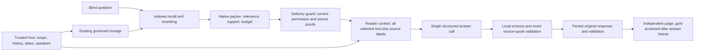

# Benchmark reliability v3 — source-bound answers and evidence selection

**Current status (2026-10-15):** the subsequent
[generalization audit](BENCHMARK_PACKING_GENERALIZATION.md) found required-evidence
regressions in v3. Native kernels default to frozen v2 selection; v3 is an explicit
experimental opt-in. The 3/3 result below remains a historical development
regression result, not acceptance of v3 as the default packing strategy.

This version repairs native evidence selection and adds an explicit structured
reader. It does not re-ingest frozen histories, rewrite earlier answers, change
past scores, or enable query-facet expansion. New evaluations use a separate
protocol, output directory, runtime hashes, and inherited cumulative accounting.

## Architecture and responsibilities

The packer owns the content-token and item limits. The reader owns framing and
output validation; it cannot repair a missed candidate or silently select a
second set of evidence. The independent evaluator owns correctness judgment.
No answer or reader quote is automatically promoted to an authoritative fact.

## Native packing

The v3 policy retains the existing scope, deletion, valid-time, system-time,
indexed-source identity, and dialogue-boundary checks. It uses generic query
content anchors, cached evidence terms, source spans, and relevance scores; no
benchmark IDs, reference answers, or domain-specific amount/occupation rules
enter selection.

- A narrowed passage retains source identity but cannot blindly retain its
  parent's relevance. Retained query support discounts the inherited score.
  For semantic-only parents, retained text provides a conservative bound;
  lack of lexical overlap does not automatically invalidate a semantic match.
- Unreranked adjacent context explicitly marked as inheriting an anchor gets
  a bounded relevance multiplier of 0.8–0.9. A pronoun or answer-only neighbour
  with no lexical overlap remains eligible; direct semantic hits keep their
  original relevance basis.
- Within 0.12 of the strongest feasible effective relevance, selection combines
  coverage, marginal missing-topic reward (at most 0.08), and soft query-support
  MMR repetition penalty (at most 0.08). Under budget pressure, token cost adds
  at most 0.10 penalty using remaining tokens per remaining item slot. These
  fixed bounds protect clear relevance gaps and prevent unlimited keyword
  diversity from dominating selection.
- After compact selection, spare tokens expand only already selected EVENT
  windows into precomputed contiguous supersets. Distinct source events share
  growth opportunities; independent claims are not evicted to make room. Final
  token counts, citation spans and trace offsets are rebuilt from the expanded
  text. Selection-stage scores remain explicitly labelled as such.
- Different claims from the same source remain separate candidates. Source
  equality is not truth equality and cannot justify removing contradictions.
- Selected source windows retain contiguous original text and exact offsets.
  Citation proofs and diagnostics describe the final delivered representation.

These are heuristic allocation rules. `coverage: partial` and
`world_negative: false` continue to apply even when all query words are covered.
Source-session recall does not prove that an amount, date, relationship, or
updated value reached the reader.

## Reader contract

`examples/memory_evidence_reader.py` provides one shared v3 prompt, response
schema, provenance renderer, and validator. Each JSON evidence block has an
`evidence_id`, original text, kind, source IDs, and available source dates,
speakers and spans. Missing host metadata is explicitly `unknown`. A claim's
creation timestamp is never substituted for the source's date. Derived claims
remain summaries rather than additional independent sources.

Native content stays within 2048 estimated tokens and eight items. Text is not
clipped again. JSON labels and escaping have a separately reported 8192-byte
ceiling; decoded evidence text has an 8192-byte ceiling. Framing overflow fails
explicitly. Actual model input includes these labels, the prompt and schema;
smaller evidence content alone does not establish lower total cost.

The model returns `answerable`, `answer`, `supporting_quotes` bound to block IDs,
and `missing_information`. A supported answer requires exact original-text
quotes in the named delivered blocks. A refusal requires a concrete missing
fact or unresolved relationship. Malformed structure or invented quotes are
protocol errors, not ordinary refusals. The original completion is preserved
before rendering, with no automatic retry. Exact substring validation proves
traceability only: `entailment_verified` remains false.

## Entry points and compatibility

- New public HTTPS and local smoke CLI runs default to `--reader-version v3`.
  Explicit `--reader-version v2` preserves the historical plain answer protocol.
  Existing callable APIs retain their v2 defaults for compatibility.
- Full LongMemEval supports `--reader-mode structured-v3`; its existing `direct`
  and `structured` modes remain unchanged. External adapters or snapshot replay
  without trusted source dates report them as unknown.
- Protocol manifests include the shared reader source hash, prompt/schema
  versions, generation settings and separate content/framing limits.
- Raw baselines retain their explicit legacy selection budget. They are not
  equal-budget native-core comparisons merely because they share a reader.

## Acceptance and limits

The repair check uses immutable copies of the 14 completed development cases
and freezes each version's blind retrieval before reading reference labels.
These cases are already exposed development regressions, not held-out evidence
of general benchmark improvement. The original 11-answer score and the later
three-answer result remain separate and unchanged.

The first candidate repair was rejected: compact representations still filled
all eight slots with similar facts, omitted one required operand, and lost an
updated count while preserving the correct source session. That failed replay
is retained separately; successful synthetic tests were insufficient acceptance.

The second candidate restored the updated count and source context but still
missed the second operand. The final `support_cost_bounded_v3_r3` policy adds
soft repetition control and corrects adjacent-score inheritance. All 14 frozen
cases passed the final manual fact-delivery regression gate: both operands and
the occupation now reach the reader, and no newly lost necessary fact was
identified relative to v2. This audit is not a new answer-accuracy score. Some
facts are now delivered mainly as extracted claims, with less direct original
text beside them; source identity and exact claim quotes do not independently
verify extraction correctness.

Final focused repository checks: **513 passed, 173 skipped**, plus **45**
external no-network accounting/orchestration checks. The repository-wide suite
was not run. Skips are environment/optional-data dependent and are reported
separately from passing tests.

The final live regression reused the same three completed databases: no new
extraction, three DeepSeek-V4.1-Flash answers, and three independent
Qwen3.8-Max-0902 judgments under the same recorded rubric. The two failed cases
(previous occupation and two-purchase total) now pass; the previously correct
date-difference control still passes: **1/3 → 3/3**. Each new answer has valid
source-bound quotes. Old answers/scores are unchanged, and this does not revise
the original 11-case score or estimate full LongMemEval accuracy. Packing,
framing, answer instructions and the output cap changed together, so this is
not an isolated causal ablation.

Six successful requests added an estimated **0.035220 CNY**, bringing cumulative
charged/reserved cost to **3.3281661 CNY** within the existing 20 CNY cap. Historical
unknown reservations remain included. This repair did not demonstrate savings:
the three answer calls grew from 5543/39 input/output tokens to 12730/332 and
from 0.011398 to 0.028116 CNY. Explicit source framing and support quotes cost
more; future cost optimization needs a separate quality-preserving validation.

Remaining corpus-wide candidate discovery, multilingual semantic retrieval,
full LongMemEval accuracy, and controlled latency/cost acceptance are outside
the claims of this small repair check.
