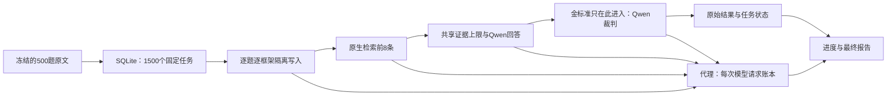

# 完整 LongMemEval-S 本地三框架运行

本流程逐题运行官方清理版 LongMemEval-S 的全部500道问题，分别写入 Agent Memory、Mem0 OSS、Graphiti，形成 **500 × 3 = 1500个固定任务**。入口是 `examples/longmemeval_full_comparison.py`。每个“问题×框架”独立创建数据库、身份、请求代理和模型账本，以 SQLite 任务账本恢复进度。

该可选worker使用Unix进程锁，当前用于macOS/Linux；本轮在macOS运行。这不改变核心包的平台支持范围。

该文档说明默认完整计划的运行与验收口径，不代表1500项已经完成。六条合成原文的短测、旧六题历史试跑及助手语义复核都是其他实验，其成绩和调用不能混入本次质量分母。短测原始归档保存在执行者本地 `.ecc/benchmarks/unified-memory-v72-qwen35-20261010/`，不随仓库发布。

## 数据与固定协议

数据使用[官方清理数据集](https://huggingface.co/datasets/xiaowu0162/longmemeval-cleaned)的 `longmemeval_s_cleaned.json`。本机文件在仓库外的 `../benchmark-data/longmemeval_s_cleaned.json`，大小277383467字节，SHA-256为：

```text
d6f21ea9d60a0d56f34a05b609c79c88a451d2ae03597821ea3d5a9678c3a442
```

worker拒绝数据哈希不符、题量不等于500或question_id不唯一的输入，不支持用limit/offset把局部运行冒充完整计划。当前入口另支持显式 `--arms` 和 `--question-ids` 做回归，先校验完整原始数据，再按选择建立独立分母；此类运行必须标为子集，不能按1500项完整计划报告。见[快照复放与回归](LONGMEMEVAL_RETRIEVAL_REPLAY.md)。

| 项目 | 本轮设置 |
|---|---|
| 执行顺序 | 原始数据集顺序；每题依次Agent Memory、Mem0 OSS、Graphiti |
| 原文 | 按原始session数组顺序写入全部历史，UTF-8片段上限9000字节 |
| 生成、回答、裁判 | 本地Ollama `qwen3.5:9b` |
| 嵌入 | 本地Ollama `nomic-embed-text` |
| 生成公共设置 | temperature=0、num_ctx=32768、seed=42、thinking=false |
| Python进程隔离 | PYTHONHASHSEED=42、PYTHONNOUSERSITE=1、移除PYTHONPATH；hash seed也进入manifest |
| 检索与回答 | 各框架原生前8条；相同8192 UTF-8字节证据上限与回答提示；回答生成上限384 token |
| 抽取 | 原生提示和预算不同；Agent1536、Mem02048、Graphiti8192/16384 token，以实际账本为准 |
| Graphiti | 每片段最多8个实体/关系；最近2个episode参与抽取上下文，全部历史仍入图 |
| 判分 | 沿用官方任务类别的yes/no提示，本地Qwen输出必须严格匹配yes或no，否则judge_label为null |
| 超时 | 本次单操作/请求900秒；入口默认300秒，启动命令明确覆盖；不是整题完成时间上限 |
| 请求预算 | 默认每个任务尝试最多10000次HTTP请求，包含代理可见的元数据请求 |
| 重试 | 默认最多2个任务尝试；历史尝试的全部调用仍计入成本记录 |

这是使用公开数据集和官方任务提示的本地复现，**Qwen判分不是官方GPT-4o裁判成绩**，也不是独立人工核验。官方判分代码支持不同模型，但本项目更换裁判后不得与论文/官方结果直接混称。[官方判分实现](https://github.com/xiaowu0162/LongMemEval/blob/main/src/evaluation/evaluate_qa.py)

抽取、检索和共享回答不接收gold answer、answer_session_ids或has_answer。金标准只进入最后的裁判和结果存档。三个后端都接收原始会话文本；保留原文、事实或关系的方式不同，因此资源预算与内部算法不能声称完全一致。Agent使用通用UnifiedMemory适配路径，本次不替代v7.2可信宿主绑定、项目权威核验、L2/L3演化等业务验收。

## 启动前检查

以下命令从仓库根目录运行，以仓库相邻目录保存本地数据和结果。`LME_RUN` 必须指向已准备好 `.venv`、wheel安装的核心包及 `runner_snapshot` 的冻结运行目录；恢复原实验时选择原目录，新实验使用新目录。恢复不读取工作区持续修改的源码，也不使用editable安装。下例的运行名和来源提交对应2026-10-10历史协议，不能把当前脚本复制进去后当作同一运行续跑。

```sh
LME_RUN="$PWD/../acceptance-reports/longmemeval-s-full-qwen35-20261010"
LME_DATA="$PWD/../benchmark-data/longmemeval_s_cleaned.json"
```

核对数据及本机Ollama缓存，只读命令不会生成回答：

```sh
shasum -a 256 "$LME_DATA"
curl --fail --silent http://127.0.0.1:11434/api/version
curl --fail --silent http://127.0.0.1:11434/api/tags
"$LME_RUN/.venv/bin/python" "$LME_RUN/runner_snapshot/longmemeval_full_comparison.py" --help
```

必须已有运行中的Ollama和两个缓存模型。runner检查模型名称，首次写入manifest时冻结实际digest、Ollama版本、Python与SDK版本、核心包内容哈希、执行脚本哈希、提示哈希、数据哈希及参数。复现短测参考版本为mem0ai2.2.1、graphiti-core0.30.2、ollama SDK0.6.2、falkordblite0.10.0；正式长测以自身manifest和依赖锁文件为准。

依赖锁文件已存于本次输出目录的requirements.lock.txt，构建wheel保存在artifacts/，环境校验结果另存environment_validation.json。首次运行前将执行脚本放入runner_snapshot/并冻结环境；新实验使用新目录。长跑中改动工作区不应修改这套冻结环境。修改冻结目录中任何被哈希的源码、升级SDK或替换模型，会使同一目录恢复时的协议不再匹配。

## 执行完整1500任务

以下命令与当前入口参数一致；运行日志和结果保存在仓库外，模型请求仅转发到指定的本机loopback服务：

```sh
env -u PYTHONPATH PYTHONHASHSEED=42 PYTHONNOUSERSITE=1 \
  "$LME_RUN/.venv/bin/python" -u "$LME_RUN/runner_snapshot/longmemeval_full_comparison.py" \
  --data "$LME_DATA" \
  --output-dir "$LME_RUN" \
  --upstream http://127.0.0.1:11434 \
  --timeout 900 \
  --request-budget 10000 \
  --max-attempts 2 \
  --source-commit 6dbb4f82f2ac2bafcd7f58eccda0b3ff11fb3579 \
  >> "$LME_RUN/run.log" 2>&1
```

这是本次启动及恢复的固定参数和进程环境；运行日志文件名可另选，但需保留历次执行日志。PYTHONHASHSEED未设为42会使冻结manifest不匹配；移除PYTHONPATH并禁止用户site包可避免导入工作区或其他环境中的包。`--source-commit`在首次和每次恢复使用同一完整SHA。它只固定来源标签，不能替代实际核心包和脚本内容哈希。

整题需要写入全部历史，可能执行大量抽取与嵌入；不得把短测每轮几十秒当作长测单题或总时间估计。避免同机并行跑另一套模型实验，否则wall时间反映了资源争用。worker.lock通过操作系统文件锁阻止两个worker同时恢复同一结果目录。



## 看进度与恢复

主进度文件是输出目录的 `progress.json` 和 `REPORT.md`。它们在任务开始、结束或可捕获中断时更新。`current_task.json`在每个会话写入完成后更新question_id、arm、attempt、session_completed/session_total、ingested_events与该尝试用量，执行日志也记录会话进度。不要将一个尚未完成的题目误认为worker没有工作。

只读查看摘要，不加载277MB历史数据：

```sh
"$LME_RUN/.venv/bin/python" - "$LME_RUN" <<'PY'
import json
import sys
from pathlib import Path
root = Path(sys.argv[1])
path = root / 'progress.json'
report = json.loads(path.read_text())
print('status:', report['status'], 'complete:', report['is_complete'])
print(json.dumps(report['task_summary'], ensure_ascii=False, indent=2))
current = root / 'current_task.json'
if current.exists():
    print(json.dumps(json.loads(current.read_text()), ensure_ascii=False, indent=2))
PY
```

终止前先让进程处理Ctrl-C并结算在途调用。超时会等待SDK原调用结束；清理错误或仍有未结算请求会中止整轮，不继续下一题。若进程硬退出，启动时由任务账本恢复运行中任务并按尝试上限重新安排。

恢复时重新执行上面的**冻结.venv＋runner_snapshot命令**，使用同一输出目录、数据、版本、模型digest和参数，先确认旧进程已经退出。不得以工作区的examples/longmemeval_full_comparison.py替换恢复入口。已完成任务和已达到上限的终态失败不重复执行；待运行及可重试任务继续。不能手工删除账本任务、只复制部分结果JSONL或提高max-attempts后假装同一协议续跑。更换模型、提示、依赖、检索配置或重试政策，应创建新输出目录。

命令以 `>>` 追加日志，也可为每个执行进程使用独立日志文件；这不影响协议参数。恢复计时来自execution.json中的首次started_at，包含停止期间，因此累计elapsed_seconds是含中断的日历wall，不应冒称模型持续计算时间。

若进程硬退出时某次代理请求还没写入JSONL，它的用量不能仅靠恢复后的账本推定完整。累计 `abandoned_attempts` 直接查询 SQLite attempts 表；`execution.json` 中的同名字段只是展示快照，不是报告来源。即使恢复事务提交后、JSON 写入前再次崩溃，重复恢复也不会漏掉已记录的中断尝试。末尾破损的JSONL行会隔离备份，并记入accounting_gaps.json；非末尾格式损坏则拒绝静默恢复。

调用日志追加、flush 或 fsync 失败后，代理锁存计量错误：`drain/close` 返回失败，退出代理上下文抛出 `ModelAccountingError`，后续请求返回503且不再转发上游。原请求可能已收到答案，但不能据此完成任务或继续下一题。代理尽力保存不含正文的 `calls/*.accounting-error.json`；重启后仍保留未知状态，不因路径恢复可写而自动清除。若磁盘故障连该标记也无法保存，不能承诺已持久记录错误；已提交的 running attempt 保持未完成，恢复后成为 abandoned，避免虚报完整计量。

`progress.json.accounting_integrity` 从 SQLite 派生 abandoned、running 和显式计量失败尝试数，同时列出持久化失败标记及隔离残尾。存在任一项时，用量可能未知；进行中报告也不宣告成本完整。已保存记录全部入账，但未记录请求仍属未知，不能把未知调用或token补零。上述行为只适用于采用新脚本的新运行，不修改历史冻结脚本或既有实验成绩。

## 分母、成本与终态验收

RunLedger的SQL摘要是任务统计来源。每个框架分母固定500，总分母固定1500：

- started：至少启动一次的唯一任务数；attempts：任务尝试累计数，重试不增加计划任务数。
- completed：流程完成的任务；scored：其中裁判给出布尔标签的任务；correct：布尔标签为true的任务。
- failed：达到尝试上限的终态失败；pending、running：尚未完成的任务。completed但judge_label为null仍是未评分项。
- accuracy_all_planned＝correct/planned。failed、judge null、pending、running都保留在固定分母；进行中的该值是进度覆盖率，不能作为最终准确率。
- accuracy_scored_only使用较小的scored分母，仅作辅助指标，不能替代主分数或掩盖失败。

状态为running/interrupted/paused、仍有pending/running、或is_complete=false时，报告必须称进度快照，不能宣布完整结果或推导框架排名。终态要求pending=0、running=0、completed+failed=1500、每臂planned=500及is_complete=true；completed_with_failures表示计划已全部终结，仍需报告失败和未评分数量。即使状态completed，也要检查judge null，不能认定1500项都被有效判分。

模型用量按每次实际请求统计，分别显示每框架的memory chat、共享answer chat、judge chat、embedding。SDK失败和重试、任务重跑、最终未得分的任务都消耗资源，全部已记录尝试入账。GET tags/version等元数据请求单列，不计模型调用。服务端缺失usage保留null及缺失调用数，嵌入输出token通常不适用；已测小计不等于完整总成本。没有电费、能耗或计费价格证据，不宣称美元成本下降。

报告的wall来自执行时间或任务秒数，**不能把可并发代理请求的elapsed_seconds相加当wall**。做效率比较还必须披露setup/cleanup、中断等待、运行顺序、原生提示/生成预算和检索表示差异。报告包含实际模型配置分布，Graphiti关系抽取的16384上限不能被初始化的8192设置覆盖。

## 应保留的复现材料

| 文件 | 用途 |
|---|---|
| manifest.json | 数据、代码、核心包、模型、提示、SDK与执行参数冻结清单 |
| run.sqlite3及运行时SQLite配套文件 | 唯一任务账本与恢复依据；进程停止后再备份，避免复制到不一致的事务状态 |
| calls/*.jsonl | 每题每臂每次尝试及元数据的请求账本 |
| agent-memory.jsonl、mem0-oss.jsonl、graphiti.jsonl | 最终完成/终态失败结果的导出，含原答案、裁判输出与证据；不是任务进度权威来源 |
| progress.json、REPORT.md | SQL摘要加模型账本生成的进度或最终结果 |
| current_task.json | 当前框架×题目、尝试及每会话进度，不替代全局任务统计 |
| execution.json | 首次启动时间及含中断wall的口径 |
| accounting_gaps.json、隔离的账本残尾 | 硬退出/日志破损导致的未知用量与原字节证据，若发生才存在 |
| calls/*.accounting-error.json | 计量持久化失败的未知标记，仅保存错误类型；整盘写入失败时可能无法产生，任务账本仍不能完成当前尝试 |
| runner_snapshot/ | 执行脚本字节快照；恢复还需要对应核心包和依赖环境 |
| .venv/、artifacts/、requirements.lock.txt | 非editable环境、构建wheel与实际依赖；恢复使用该环境 |
| environment_validation.json、执行日志、数据SOURCE.md | 环境校验、异常与数据来源；归档时一并保存 |

模型账本不保存请求正文；逐题结果可能保留公开基准原文衍生的证据。本轮数据在仓库外，归档前核对冻结哈希即可，不需要把277MB数据提交到GitHub。源码和文档可以提交，成绩发布前应确认1500项终态及所有限制都被写入最终报告。

相关说明：[短测协议](UNIFIED_LOCAL_BENCHMARK.md)、[旧LongMemEval运行记录](LONGMEMEVAL_COMPARISON.md)、[官方项目](https://github.com/xiaowu0162/LongMemEval)。
