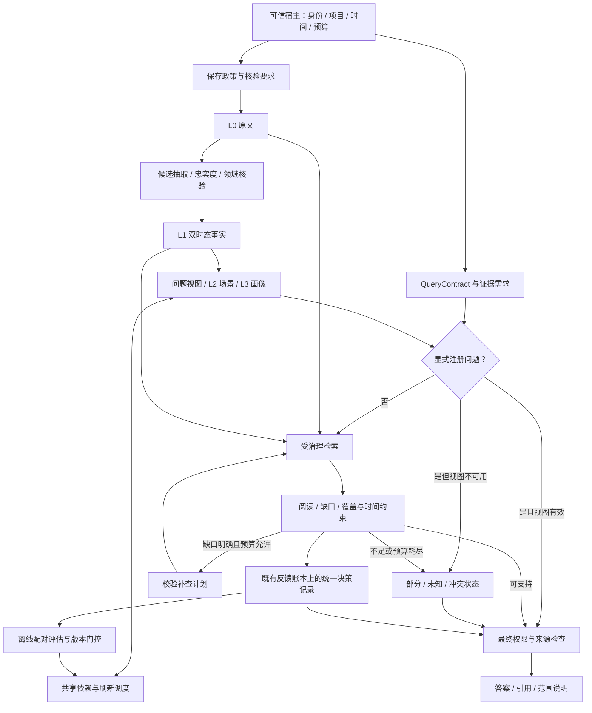
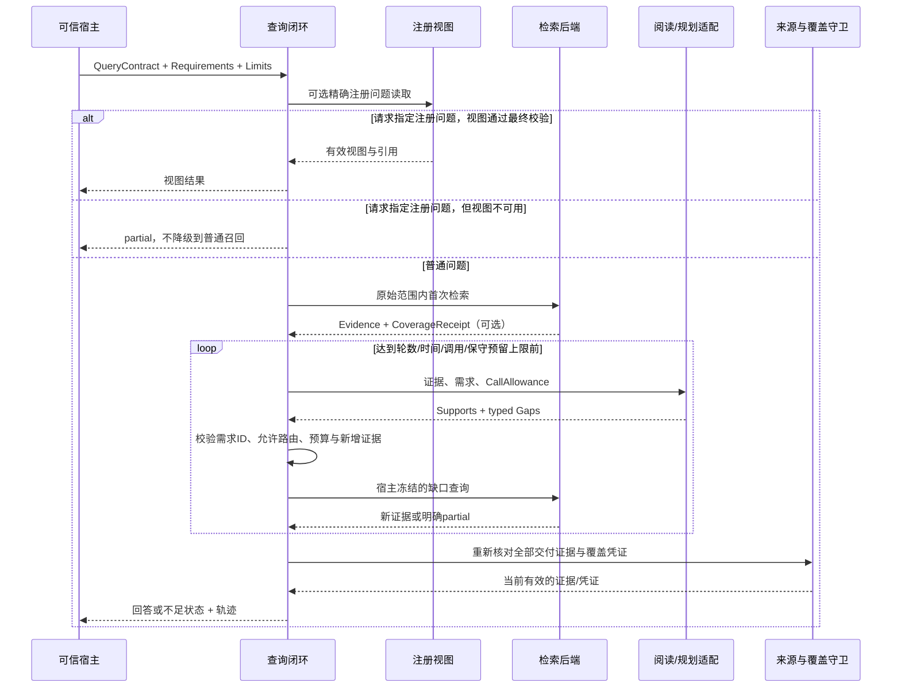

# Agent Memory v7.3：证据驱动查询与可撤回经验

- 日期：2026-10-22（Asia/Shanghai）。
- 基线：v7.2 记忆生命周期 + 已合并 QA 修复，Git `5849c26`。
- 版本边界：架构 v7.3；软件包仍为 0.1.0 / Alpha；新查询协议显式启用。
- 本轮工程状态、局部验证和外部验收限制见 [任务表](v7.3.0/task.md)。
- 本文不改变既有事实准入、双时态和当前授权语义。真实模型质量、完整公共基准和业务 LIFE-07 分别验收。

## 1. 目标与复用范围

在已有可追溯事实、问题视图和来源窗口基础上，连接“明确证据需求 → 定向补查 → 最终重验 → 有界回答”。
同时连接策略失效与外部部署撤回，令决策和刷新收益可记录、可回放、可撤销。

已有能力继续使用：L0 原文、BusinessAdmissionPolicy、L1 双时态、L2/L3 演化、
源依赖与反向订阅、QuestionService、RefreshDemandQueue、ModelBudget、CAS 发布与最终读取守卫。
程序经验已有 Procedure/Episode 与可选 evolution 状态机；冷热、去抖和优先级已有实现。
默认打包仍为原有稳定协议；实验 packing v4/v5、reader v4 不因本文自动变为默认生产路径。

## 2. 总体架构

## 3. 模块责任与依赖

| 位置 | 本轮责任 | 边界 |
| --- | --- | --- |
| `retrieval/evidence_research_contracts.py` | 查询、需求、缺口、调用额度、覆盖凭证、时间精度与结果合同 | 身份、范围、时间和检索表达式由宿主冻结 |
| `retrieval/evidence_research.py` | 有限轮补查、预算、停止条件与最终交付 | 不写 L1、不执行外部业务工具、不导入 evaluation/examples |
| `retrieval/evidence_research_adapters.py` | 本地检索、视图、独立语义入口、覆盖凭证与最终守卫适配 | SQLite 快照；其他后端需要实现对应端口 |
| `retrieval/evidence_research_reader.py` | 严格 JSON 阅读器与宿主 transport 端口 | 不内置供应商请求；实际调用需接宿主费用账本 |
| `context/source_recovery.py` | 版本化原文定位和恢复 | 复用现有源仓储，不创建第二份原文库 |
| `operations/decision_records.py` | 统一政策记录与既有 DecisionRecord/反馈账本接线 | 不创建另一套决策存储 |
| `operations/refresh_observations.py` | 完整工作量观测、配对收益与冷热建议 | 费用依旧引用 ModelBudget，资源单位不冒充货币 |
| `packages/evolution/` | 来源失效补偿、多步骤候选、Skill 适配 | 可选依赖；宿主控制部署和执行授权 |
| `evaluation/qa_optimization.py` | 冻结计划、配对分组统计、完整质量/成本门控 | 生产代码不导入；不执行收费调用 |

保持模块化单体、核心零第三方运行时依赖。业务规则归属原模块，装配层组合端口；
不新增万能管理器、向量数据库强依赖或第二套后台队列。

## 4. 查询算法与数据流

具体约束：

1. 查询和需求由可信宿主绑定。阅读器只能选择已声明需求 ID 和允许的路线，不能扩大范围、
   修改授权、重写检索表达式或自签完整覆盖凭证。
2. 原生检索和独立语义入口是可选能力。语义候选可绕过词面候选门槛，但交付仍须经过原文与权限守卫。
3. 本轮最大轮数、调用数、模型调用数、保守输入/输出预留、墙钟时间与证据数量均有硬上界。
   `reserved_tokens` 的口径明确为 UTF-8 输入字节数加输出 token 上限，不冒充精确 tokenizer 计量。
   成功调用、调用预留、未知用量和已知实际 token 分别记录；失败不释放保守预留。
   实际金额与服务端计费仍由 ModelBudget/宿主适配负责。
4. 相同证据不算进展。没有新增证据、没有合法补查计划、预算耗尽或超时都停止。
5. 引文匹配、需求覆盖、语义支持分别记录。模型阅读仍可能出错；输出不自称逻辑蕴含已验证。
6. 最终来源失效或覆盖变化时，旧答案不交付。无效权限或删除不等待后台刷新。
7. `SQLiteVectorResearchRoute` 是独立候选的有界参考适配：最多 4096 个来源，
   每个来源最多 4096 字符，总向量坐标最多 1048576；没有实现持久化生产向量索引。
8. 最终守卫后没有外部异步调用，避免检查后又写日志或调模型形成新的等待窗口。

### 4.1 完整性

“相关”不等于“支持”，“支持部分结论”不等于“覆盖整个集合”。
完整枚举和否定答案只接受可信后端在注册范围上的覆盖凭证，绑定查询、来源版本和集合快照；
最终读取再次验证成员集合，包括空集合。预算裁剪、索引缺口或不支持的历史查询保持 partial。
完整性限于注册且已授权、已收录的集合，不证明现实世界没有遗漏，也不证明原文中的陈述真实。
当前 census 按宿主注册的 `event_type` 枚举来源行，不替任意自然语言筛选签发完整性证明。
研究适配的历史查询明确返回 partial；既有 Claim 与已注册问题视图的历史能力保持原合同。

### 4.2 时间精度

来源精确到月时可回答月；要求日级且证据不足时返回不足。近似时间保留限定。
`TemporalResolution` 来自宿主提供的时间抽取/计算，绑定交付证据；不能把消息写入时间当成事件发生时间。
`valid_at` 和 `known_at` 继续沿用原有双时态语义。

## 5. 可恢复压缩

`UnifiedMemory.local(..., recovery_path=..., recoverable_compression=True)` 显式开启。
生成压缩建议之前，核对片段确为授权原文的唯一连续片段，并记录来源 ID、范围摘要、
全文哈希、字符起止位置和片段哈希；元数据计入输入预算。

`recover_compressed_source(summary_id, source_event_id)` 只恢复当前建议中已保存的引用。
建议失效、恢复状态版本改变、原文变化、归档、删除或跨范围读取都拒绝恢复。
原文通过现有源仓储读取，不把磁盘路径、URL 或可执行指令写入恢复合同。
此能力证明可恢复性，不保证摘要忠实度；自定义压缩仍需已有宿主验证器。
原文恢复后重新验证同一摘要、来源与策略，最后在恢复库的同一读快照中核对摘要和状态版本。
SQLite 与分区恢复库提供 `compression_current`；自定义恢复库启用原文恢复前必须实现该快照端口。
这不是跨来源库、恢复库和策略库的分布式事务；多控制器共享部署须由宿主串行化写入与交付。

## 6. 决策与刷新收益

保存价值、事实核验、检索需求、刷新收益和策略演化分别判定。共享记录格式包含阶段、
动作、原因、策略/输入版本、来源引用、结果与费用回执引用。它包装到既有反馈账本，
保留作用域、幂等和删除语义。`PolicyDecisionRecord` 通过可选的 `PolicyDecisionDetails`
写入既有 `DecisionRecord`，原调用者无需迁移；引用的原生记忆必须属于当前作用域且仍可用。

冷热判断使用完整配对工作量观测，包含写入、依赖维护、后台刷新、前台读取、失败与收尾。
没有测量、未结算责任或单位不一致时，收益未知；不能用估计的“省钱”触发自动升温。
调用者先观察建议，再通过策略 revision/CAS 显式应用。已有最小样本、驻留时间和滞回规则继续生效。
观测基于可信宿主；合同不能证明伪造的测量数据真实，也不能自动发现宿主隐瞒的外部调用。
没有显式确认调用数时保持未知；声明零调用和提供完整费用回执由宿主承担。

## 7. 程序经验与撤回

复用 candidate → offline → shadow → canary → active → rollback 的状态机。
多步骤候选保留来源 Episode、内容版本、适用条件、失败样本、工具约束与成功标准。
Skill 导出是可选制品，不等同于执行授权；每次使用仍核对当前活动版本与证据。

来源失效在 registry 事务内关闭活动指针并保存待撤回标记，随后调用幂等的外部停用端口。
停用失败、进程崩溃或晚到的激活副作用保留补偿责任；重启恢复后继续停用。
失效来源不能通过重新注册新候选复活。跨包删除桥复用 UnifiedMemory 的删除日志。
擦除先拒绝访问并持久化待擦除责任，完成外部停用后清除程序正文、来源片段和评估自由文本，
只保留作用域、标识、版本和状态等最小 tombstone；归档仍保留历史。
SQLite 空闲页、备份与宿主部署介质的物理清理不由该逻辑擦除协议保证。

兼容变化：evolution 的 `invalidate_sources` 增加必填 `scope`，避免同名 source ID 跨范围失效。
外部部署遵循该包单控制宿主约束；不能把本地拒用等同于已撤销外部系统里的不可逆动作。

## 8. 验收与成本

`QAOptimizationPlan` 在实验前冻结案例、历史分组、任务类别、可回答性、数据/模型/评分器、
工作负载摘要、统计协议和阈值。两个版本必须绑定同一计划，配置变化分别记录。
`QAExecutionManifest` 另外记录实际运行的数据、回答模型、评分器和工作负载摘要，
逐项与冻结计划核对；缺失不能通过验收，不一致拒绝比较，不能只凭计划哈希宣称使用了同一配置。

配对报告复用 `CostSnapshot` 和公共 QA 合同，按完整会话/历史分组 bootstrap，
分别报告错误回答、错误弃答、技术失败、任务类别退化、P95 延迟和总成本。
缺失案例仍留在计划分母；未完整评分时 `full_benchmark_accuracy=null`。
开发暴露、离线执行、合成数据、未知治理结果、未知用量、未结算费用、后台未收尾、
缺失本地资源或样本不足均阻止完整发布验收。

原实验协议、断点、成绩和累计费用账本保持不变。新增离线测试仅证明工程合同。
用户现有累计 20 元上限下记录余额为 0.0888379 元，本轮不安排付费调用；
完整 LongMemEval 与真实业务 LIFE-07 仍需独立数据、预算和真实运行证据。

## 9. 研究借鉴与限度

- [JAM](https://arxiv.org/abs/2609.34385)：问题驱动的迭代取证；本项目保留已有视图快路和硬治理。
- [ReMe 可恢复压缩](https://github.com/agentscope-ai/ReMe/blob/main/docs/en/context_compaction.md)：
  压缩前绑定可恢复来源；本项目直接使用已有原文仓储。
- [腾讯可插拔决策服务](https://github.com/TencentCloud/TencentDB-Agent-Memory/releases/tag/v2.0.3-beta.1)：
  共享决策适配；本项目各业务模块仍拥有自己的规则。
- [STATE-Bench](https://github.com/microsoft/STATE-Bench)：后续任务成功、一致性和完整调用成本。
  当前没有运行该完整基准，不报告其成绩。

研究结果不直接等同于本项目的实测效果。实施顺序见 [plan](v7.3.0/plan.md)。
