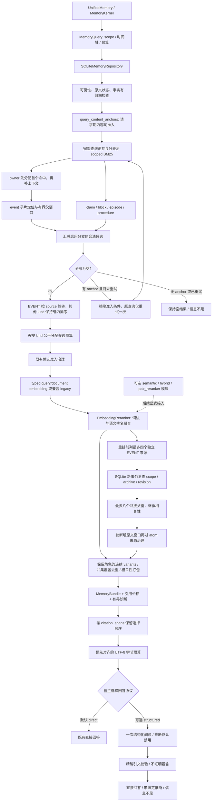

# Native 上下文检索设计

版本：1.5。更新：2026-10-12。范围：默认 SQLite/native kernel 的候选召回、语义重排、原文窗口和证据打包，以及独立的 LongMemEval 证据阅读与诊断入口。v1.5 的“快照→真实检索→回答→裁判”回放已完成：direct 为 1/3，structured thinking 为本地裁判 3/3；两组交付证据逐字相同。第三题仍将居家计划纳入实际状态答案，不代表语义全无问题，也不覆盖重新抽取入库或全量评测。

本版实现的是 **内容词准入的 scoped BM25 召回 + 有界 embedding 重排 + 重排后同源上下文扩展 + 相关性优先的完整片段打包**。它没有把独立 dense 索引、ColBERT 或多轮模型检索接入默认路径，也不改变权威事实、权限、删除和双时态的职责。结构化证据阅读器是可选、独立的回答协议，不算作新检索能力。

## 问题与证据边界

[上一轮三题复测报告](../../evaluation/LONGMEMEVAL_V15_REGRESSION.md#diagnostics)记录了 1,768 次事实抽取接纳，但最终 24 条证据全部是 event，裁判结果仍为 0/3。接纳次数不等于独立有效事实数量；原结果缺少中间候选，不能据此证明目标事实已抽出后又被某一阶段淘汰。

源码确认了可泛化的缺陷：词法排序缺少 IDF；不同表示的手写分数混排后提前截断；embedding 只能看到截断后的候选；小片段可能断开指代和限定关系；打包的查询词覆盖奖励远大于相关性排序贡献。瑜伽题还存在阅读器误解：证据已出现场馆名称，回答却额外要求具体地址。因此检索与阅读器必须分开验收。

v1.1 进一步修复两类交接问题：同一来源的多个窗口可能在候选截断时占满名额；适配器按 `item.score` 再排序可能撤销打包器的去冗余选择顺序，而且 8,192 估计 tokens 的结果会在 8,192 UTF-8 字节的下游预算中被硬截断。修复覆盖来源与表示两层候选机会、打包顺序传递和预算单位衔接；已冻结的 v1 实验不会被改写。

v1.2 补齐检索 embedding 的输入用途契约：query 与 document 由调用边界区分，Nomic provider 按模型要求添加不同前缀，并禁止服务静默截断。它修复已确认的模型使用缺省；对真实排序与问答的收益仍须同快照验证。抽取中的说话者角色污染与每块最多八条候选造成的遗漏不在本版修复范围，同快照复放也无法验证这些入库问题已解决。

v1.3 增加查询期内容词准入和四子片父窗口。[首题噪声诊断](../../evaluation/LONGMEMEVAL_V15_REGRESSION.md#diagnostics)仅用原问题重放词法候选：48 个候选中，43 个没有四个主题词的字面命中；24 个 claim 全部没有这些命中。短事实集合中的 `I`、`where` 和数字 `5` 仍可能具有较高 IDF，表示间公平分配会让这类弱相关事实取得候选机会。真实 embedding 也曾将部分噪声排在前列，不能假定重排必然修复候选质量。此次准入策略不使用金标答案，但字面主题词覆盖也不等同于语义相关性，不能据此认定上述 43 项全部无用。

v1.4 针对已观察到的两项边界补齐机制：来源广度曾挤掉同源互补窗口，因此在重排之后按独立来源补读有限邻窗；预算缩片曾产生很短、关系不完整的片段，因此改为有界句/行 variants，无可用片段时跳过。另增加可选结构化阅读器，区分明确陈述、上下文推断和信息不足；它不回写记忆。实现契约与问答收益分别验证，不能把多个模块变化合并宣称为新检索算法的效果。

v1.5 补齐同源区间并集覆盖去重、缩片起点的可见说话者限定和 malformed span 防御，并提供显式 reader thinking 与输出预算参数。既有角色污染的入库问题不因此解决；字面角色标签只保留原文语境，不认证说话者。固定 v1.4 证据的阅读诊断与 v1.5 真实检索回放分别保留，不混用成绩。

本次不使用题号、标准答案或金标会话修改检索规则。三题仅是历史错误回归，不能作为全量准确率或跨框架排名。

## 总体架构



仓库负责权威读取和定位；`analyzer.py` 负责分词与独立版本的查询准入策略；`candidate_selection.py` 负责来源/表示间预算与无正文诊断；`providers.py` 负责请求内向量重排。`source_context.py` 提供厂商无关的 anchor 选择与上限，`sqlite_source_context.py` 实现受治理的索引头查询及原文切片，kernel 编排可选扩展；`packing.py` 负责预算、去冗余、引用及选择顺序还原。`examples/memory_evidence_reader.py` 仅消费已交付证据，既不检索也不写记忆。图中的分支汇总判断是仓库级兜底边界，不把单个空 kind 当作重试条件。

## 数据流与算法

```mermaid
flowchart LR
    RAW[原始会话 / 来源 revision] --> INDEX[1024 字符子片与词项索引]
    RAW --> EXTRACT[事实抽取与既有准入]
    EXTRACT --> CLAIM[事实及双时态版本]
    Q[原查询] --> TERMS[完整查询词项 / 既有词数上限]
    Q --> ANCHORS[内容词与引号专名 anchor]
    TERMS --> STATS[授权与时间范围内 N / df / 平均长度]
    INDEX --> STATS
    CLAIM --> STATS
    STATS --> GATE[SQL 对命中子片要求至少一个 anchor]
    ANCHORS --> GATE
    GATE --> LOC[BM25 owner 顺序 / 首命中先分配]
    LOC --> HYDRATE[合法事实 / 精确 UTF-8 父窗口]
    HYDRATE --> ALL{所有分支候选均为空?}
    ALL -->|有候选 / 无 anchor / 已重试| CAND[source 内轮次 / kind 间轮次]
    ALL -->|有 anchor 且全空且尚未重试| RETRY[完整原查询去掉 gate，仅重试一次]
    RETRY --> LOC
    CAND --> PURPOSE[query/document 用途由调用方标明]
    PURPOSE --> EMB[provider 添加模型前缀 / 单 batch embedding]
    EMB --> RRF[weighted RRF]
    RRF --> CONTEXT[按重排名次选择最多四个独立来源]
    CONTEXT --> HEADERS[复查索引头 / 同源父窗偏移正负896]
    HEADERS --> EXTRA[最多八个新窗口 / 来源治理]
    RRF --> SELECT[完整句行 variants + token 预算]
    EXTRA --> SELECT
    SELECT --> ORDER[citation_spans 还原跨 kind 顺序]
    ORDER --> FINAL[字节预算内完整的最终 evidence]
    BYTES[宿主 UTF-8 字节上限] -. 换算估计 token 上限 .-> SELECT
    CAND -. anchor policy / count / mode .-> LINEAGE[无正文候选 lineage]
    CAND -. candidate ID / kind / score .-> TRACE[无正文五阶段 trace 与引用坐标]
    RRF -. candidate ID / kind / score .-> TRACE
    EXTRA -. inherited relevance / source_context .-> TRACE
    SELECT -. selection score / redundancy / tokens .-> TRACE
```



### 1. Scoped BM25 与候选分配

每个来源表示在自身合法 corpus 内计算：

```text
idf(t) = ln(1 + (N - df(t) + 0.5) / (df(t) + 0.5))
BM25(d,q) = Σ idf(t) × 2.2 × tf(t,d)
             / (tf(t,d) + 1.2 × (0.25 + 0.75 × |d| / avgdl))
```

`N`、`df` 和平均长度来自已通过 scope、来源状态及相应时间资格条件的索引头；不读取正文。SQL 先按 BM25、再按 IDF 加权覆盖和稳定身份排序。保留原有 `ascii-han/1` 分词与查询词数上限，不为三题添加关键词，不删除数字、日期或否定词的评分贡献。不同表示的 BM25 原始分数不直接比较。

v1.3 的 `query_content_anchors()` 使用独立策略版本 `content-anchor/1`，仅决定候选能否进入，不改索引分词、不要求重建索引：

```text
anchors(q) = 查询词中非英语功能词、非普通纯数字、非否定词的词项
             ∪ 引号保护词项
admit(child, q) = anchors(q) 为空，或 child 至少命中一个 anchor
```

这是有界英语启发式，覆盖疑问词、助动词、代词等；不是词性分析、实体识别或完整多语言语法。引号按词项保护专名，例如 `"The Who"` 保护 `who`，同时避免前导 `the` 单独准入大量文档；纯单词引号和被引号保护的数字仍可成为 anchor。保护不等于精确短语匹配。普通数字及否定仍参与 BM25，完整原查询仍交给 embedding；只是不能独立准入含主题词查询中的候选。只有数字或否定而没有 anchor 的查询继续使用原检索。金额、日期、单位和小数之间的语义区别尚未建模。

各启用分支的 SQL 在命中子片分组后以 `HAVING` 检查至少一个 anchor，再做 owner 排序和数量截断；授权与时间过滤不变，BM25 统计仍基于原合法 corpus 和原查询词。只在所有分支汇总候选为空且存在 anchor 时，统一去掉此条件，用原查询重试一次。单个 kind 为空不会自行放宽；不为了填满 48 个名额补入功能词噪声。通过准入的 event 可再扩展父窗口、源尾和邻片，这些上下文候选不必各自命中 anchor，但必须继承合法命中 owner。

候选仅新增无正文的 `query_anchor_policy`、`query_anchor_count` 和 `query_anchor_mode`；模式为 `required`、`full_query_fallback` 或 `unrestricted`，不记录原问题或 anchor 字符串。其他索引/检索插件的默认行为不改变。该策略有明确召回代价：**若已有其他 anchor 命中，完全使用同义词的相关来源不会触发全空兜底，仍可能漏召**。独立 dense 召回才是后续补齐该通道的方向，当前不能称为全库混合召回。

v1.1 分两层分配候选机会：

1. **来源层**：SQLite 按 BM25 发现 owner，先给各 owner 的最强真实命中分配 locator，再补第二命中或上下文；EVENT 候选再次按公开 `item.id` 分组，每轮每个来源取一个窗口，剩余名额才取额外窗口。组内优先 `matched`、`additional_match`、`source_tail`、`adjacent`，来源间按首命中的词法分数排序，避免继承 anchor 分数的探测窗排在真实命中前。
2. **表示层**：将 EVENT 的来源轮转序列与其他 `kind` 的组内词法排序序列轮流取项，直到总名额耗尽；某组不足时，剩余名额由其他组使用。不同 claim 即使共享来源也不合并。

这两层在 locator 和最终候选截断处保留来源广度，并避免长 event 把简短 claim 全部挤出重排入口。它们是候选机会预算，**不约束最终答案必须包含多少条 fact 或多少个来源**。代价是最强来源的第二、第三个有用窗口可能让位于较弱来源的首窗口；来源覆盖增加不保证答案质量一定提高。

native kernel 请求 `query.limit × 6` 个仓库候选；本次 `limit=8` 对应 48 个。仓库内部 locator pool 为 `min(MAX_CANDIDATES, max(32, limit × 4))`；embedding 默认最多处理 48 个。IDF 聚合仍随授权 corpus 大小增长，候选数量有界不等于数据库统计工作恒定。

### 2. 子片定位、父窗口读取

索引继续使用 1,024 个 Python 字符的子片，相邻子片重叠 128 字符，步长 896。v1.3 父窗口取最多四个连续索引子片：命中子片之前两个、之后一个，以增加前文实体和指代的保留机会。起始位置为 `max(0, matched_start - 2 × 896)`，结束按从该位置起最多四个子片的实际边界计算；来源开头不足两个前片时，剩余容量向后延伸。最大跨度为 `1024 + 3 × 896 = 3712` 字符，来源末尾可更短，通用校验上限仍为 4,096 字符，策略标识为 `context_window=bounded-parent/2`。窗口在 embedding 和打包之前生成。

每个匹配 owner 最多保留四个窗口：优先两个不同词法命中，再按剩余名额尝试源尾和邻片；相同坐标去重。SQL 截断先保留各 owner 的首命中，窗口生成也惰性地按 owner 轮转，不预先为单个来源消耗四个名额。所有窗口共用原有总候选预算，locator、owner 和正文读取上限未增加。SQL 按索引记录的 UTF-8 字节边界读取原文，公开引用使用 Python 字符坐标；不把不连续片段拼成一句原话。具体字段和删除语义见[有界原文上下文召回](bounded-source-context.md)。

四个子片组成一个父窗口，与“每 owner 最多四个窗口”是两个不同上限。相比 v1–v1.2 的最多 2,816 字符父窗，v1.3 增大了单候选正文和潜在 embedding 成本，未增加候选数量或最终字节预算；结果可能放得下更少窗口，也可能在打包时缩片，不能把更长父窗当作无成本改进。

### 3. 请求内语义重排

core 在 `ports.py` 提供可选的 `RetrievalEmbeddingProvider`：

```python
async def embed_for_retrieval(
    query: str, documents: Sequence[str]
) -> Sequence[Sequence[float]]: ...
```

返回顺序固定为 query 向量在前、各 document 向量按输入顺序随后。`EmbeddingReranker` 优先调用该方法；仅实现 `embed(texts)` 的既有 provider 仍走兼容路径。用途来自接口参数，不根据问号、文本内容或字符串前缀猜测；core 不内置模型专属前缀。

本地 Ollama adapter 的 typed 路径将 query 编码为 `search_query: <原文>`，document 编码为 `search_document: <原文>`，在同一个 batch 中调用 `/api/embed`，校验数量及 768 维返回，并显式设置 `truncate=False`。这是 [Nomic v1.5 官方输入约定](https://huggingface.co/nomic-ai/nomic-embed-text-v1.5)，只改变模型输入，不修改事实正文、引用和抽取数据。输入前缀也占用模型上下文；超长输入应报错，再按既有 reranker fail-open 配置回退，不能把被截短向量误称为完整父窗口的表示。[Ollama API](https://docs.ollama.com/api/embed)说明了关闭截断时的错误行为。

本地 manifest 与官方 v1.5 发行物均为 `0a109f422b47e3a30ba2b10eca18548e944e8a23073ee3f3e947efcf3c45e59f`；模板只有 `{{ .Prompt }}`，Ollama 0.32.14 的 embedding handler 不自动添加上述任务前缀。该发行物的 GGUF context 为 2,048，模型参数 `num_ctx=8192` 不等同于实际可用 8,192；[该版本服务实现](https://github.com/ollama/ollama/blob/v0.32.14/server/routes.go#L816)取模型与配置的较小上限。字符预算和 native `token_estimate` 均不能替代 embedding 模型的 tokenizer 长度。

adapter 的 `retrieval_prefix_version=nomic-search-prefixes/1` 写入实验 manifest 的 `agent_embedding_input_contract.version`，同时记录 `roles` 和 `truncate=False`。今后若复用持久向量，此输入契约版本也必须进入索引/缓存兼容性身份；不能把未加前缀的旧向量直接与新 query 配置混用。本版只使用请求内重排，不新增持久 dense 索引。

对已进入候选集合的文本计算 cosine，分别取得 baseline 排名和语义排名后融合：

```text
RRF(d) = (0.35 / (60 + rank_lex(d)) + 0.65 / (60 + rank_sem(d))) / 1.0
```

相同分数共享相同排名，避免平分候选因任意序位产生差距。原 cosine 仅用于排序与诊断，不能当作已校准的正确概率。超出 embedding 预算的尾部保留，但分数限制在已重排集合之后；provider 错误继续按既有 fail-open 配置回退。

这里的 `rank_sem` 只覆盖已有候选，**无法发现完全没有词法命中、从未进入候选集合的同义来源**。v1.4 仅能再读已召回来源的相邻上下文，不能补足独立来源的 dense 召回。本次的 weighted RRF 不等于“BM25 与全库 dense 并行召回”。

### 4. 重排后同源上下文

kernel 在 rerank 之后、packing 之前调用仓库可选的 `expand_source_context()`。不支持此方法的 provider 保持既有路径。`source_context.py` 从重排序列选择最多 `min(4, query.limit)` 个独立 EVENT：按公开 event ID 去重，只接受有限 score 和可验证的 source-span 身份；不能用自由 metadata 伪造 owner。历史查询和非 SEMANTIC channel 禁用扩展。

SQLite 在新的读取事务中修复脏索引，再通过索引头复查每个 anchor 的 scope、未归档状态、revision、来源长度以及窗口起止边界，随后在同一事务内读取新窗口。以原父窗起点分别偏移 `-896`、`+896`，每个方向最多四个索引子片、最大 3,712 字符；按候选身份去重，总计不超过八窗。跨版本、归档或已删除的旧 anchor 不能授权新正文读取；只加载精确 UTF-8 切片，不把整篇原文装入 Python。新增窗口再次经过 kernel 的 atom 来源治理，已从 AdmissionEngine 时态路径取得的原 ranked atoms 不因此被重复用 legacy 来源规则过滤。

新增窗口 `score` 继承 anchor 的融合相关性，记录 `context_window=reranked-adjacent-parent/1`、`context_only=true`、`context_reason=reranked_adjacent`、`context_anchor_candidate_id`、`context_anchor_score` 和 `relevance_origin=inherited_context_anchor`。**它没有自己的 semantic_score，也没有重新计算 BM25 或再发 embedding 请求**；不把邻近视为该窗已被语义模型确认相关。

本次基准原 48 项 embedding 候选不变，最多 48+8=56 项进入 packing。通用 kernel 还可能加入原有 atom 候选，因此一般上限应表达为 `len(ranked)+8`，不能把 56 写成所有配置的保证。`source_context_expansion` 记录策略、状态、anchor/新增窗口数量及 `semantic_scoring=false`；trace 扩展为 candidate_recall、reranked、source_context、packing_input、packed 五阶段。

此阶段以固定的额外 SQL/正文/打包开销换取强相关来源内部的关系覆盖，没有增加 embedding batch，但不代表零成本或保证命中远处关系。继承分数也可能抬高无用邻窗，后续需共同观察互补证据进入率、打包选择、噪声和总成本。

### 5. 相关性主导的证据集合

将有限重排分数按本请求缩放到 `[0,1]`，逐步选取可在预算内交付的证据：

```text
selection(d | S) = relevance(d)
                 + 0.01 × query_coverage(d)
                 + 0.01 × new_query_coverage(d | S)
                 + 0.005 × new_source(d | S)
                 - 0.03 × max_event_redundancy(d, S)
```

同源同 revision 的 event 窗口按重叠比例计算冗余，完全相同 event 文本也会降权；不同 claim 不因共享来源被折叠。辅助项仅做有界调整，不能再以大幅词覆盖奖励推翻明显更相关的结果。这是 MMR 思路的确定性、有界实现，不是全局最优证据集合或完整语义去重。

v1.5 增加硬性零增量检查：只有同公开 event ID、同来源集合、同 revision 且各 span 几何合法时，合并已选区间；如果连续覆盖待选区间，则寻找仍含新增文本的可行 variant，否则跳过。跨来源、跨 revision、claims 和无效 span 不据此合并。坐标、正文长度及版本格式校验防止畸形 metadata 参与覆盖证明；它仍不是权限或原文真实性校验，也不会把不连续文本拼成新引文。

父窗口放得下时优先保留完整上下文；放不下时，v1.4 为每个合法、有界原文窗口预计算最多 13 个 variants（含原窗），缩片必须是可核验的连续原文。具有标点或换行的文本按保守句/行边界选片，避免把小数、首字母及常见缩写的点号误当句号；父窗在原文中部的切边不自动算完整句边界。另保留最小可用完整单元，避免几何缩片宽度跳过本来放得下的一句。边界启发式不是语言学解析器，原父窗本身仍可能切在句中。

v1.5 若看见合法行首的 `user:` / `assistant:` / `tool:` turn 头（允许前置方括号标签），缩片起点限定在这些 turn 头，保留该轮前面的角色和限定语，结尾仍可选择后续完整句/行。窗口本来已切入 turn 中间、且没有后续可见头时无法恢复缺失角色；任意文本里的角色标签不赋予身份或信任。保留起点可能让更多片段放不进剩余预算，这是完整语境与容量的显式取舍。

无标点且无换行的文本使用明确的 fallback：缩片至少 64 个字符，保留完整 ASCII 单词/标识符/数值字符，超长不可拆标识符可被判为不适配；连续汉字窗口不声称语义完整。这个下限仅约束无结构文本的缩片，合法的完整短来源仍可小于 64 字符。任何 variant 都放不下时跳过该候选，允许少于 top-k 或未用满预算，不能为了填满预算输出几个字的残片。`passage_boundary` 标明 `sentence_or_line` 或 `unbroken_min64`，引用仍是实际交付范围。

缩片的词项匹配按每词有限次数搜索，避免常见词先耗尽搜索窗口。相关性不是“事实为真”的裁决；事实的准入、争议和双时态状态继续由既有治理决定。

### 6. 选择顺序与字节预算交接

`MemoryBundle` 按 kind 分字段存储证据，`citation_spans` 保留打包时的跨 kind 选择顺序。`ordered_bundle_evidence()` 用其中的 `candidate_id` 还原已有返回项顺序，不能通过引用新增证据或授予权限。无 native 引用顺序的 provider 保留既有按分数排序行为。`CommonAgentAdapter` 使用该顺序，不再把 MMR 结果按原始 `item.score` 重排。

本地 LongMemEval 共享证据预算为 8,192 UTF-8 字节。native `token_estimate(text)` 将 ASCII 字符数按四个一组计数，并对每个非 ASCII 字符计一，因此对可编码文本有 `UTF8_bytes(text) ≤ 4 × token_estimate(text)`。适配器在请求记忆前，先为每条证据保留最多三个分隔符字节：

```text
native_token_budget = floor((evidence_byte_budget - 3 × limit) / 4)
                    = floor((8192 - 3 × 8) / 4) = 2042
```

在现有 native 估计器和证据序列化格式下，此保守换算让已打包正文和分隔符完整进入共享字节上限；最终字节检查仍然保留。它不是模型 tokenizer 的 token 上限，也不是任意 provider 的通用字节保证。非 ASCII 文本可能少用部分可用字节；收益是减少回答前的静默截断，代价是较少上下文，质量和实际字节利用率须一起记录。模型、提示词和最终 8,192 字节上限保持原协议，不能把预算换算修复当成扩大上下文。

### 7. 独立的结构化证据阅读器

`examples/memory_evidence_reader.py` 的 `evidence-reader/2` / `attribute-grounded-reader/2` 只接收原问题、日期和最多 8,192 UTF-8 字节的已治理证据。runner 默认仍为 `--reader-mode direct`；`--reader-mode structured` 显式启用结构化协议。每次 reader 调用只发一次外部生成请求，不检索、不读金标、不自行换提示重试，不修改证据顺序或边界；服务内部可能再生成，不能把一次 HTTP 请求等同于一次内部 completion。外围实验的失败重试仍按冻结 runner 协议计费和记录。

结构化响应包含 `requested_attribute`、`support_kind`、`answerable`、`answer`、`supporting_quotes`。请求的属性要与所问粒度一致，例如场馆名称不能无故扩大成具体地址；用户报告、助手建议、示例与问题在提示中明确区分。

| support_kind | 准入与呈现 |
|---|---|
| `explicit` | 关系由证据明确陈述；需要 1–4 条精确引文，呈现简短直接答案 |
| `contextual_inference` | 默认禁用；只有同时传 `--allow-contextual-inference` 才允许，要求至少两条不同引文，答案加 `Based on the conversation context, ` 限定前缀 |
| `insufficient` | 不可回答，结构化 answer 为空、引文为空；对外返回 `I don't know.` |

推断必须来自同一事件的连续语境，不能靠孤立共现、助手建议或未解决的矛盾。**这些语义要求主要由提示和模型执行，精确字符串校验不验证它们成立。** 校验器检查 JSON 字段、类型、长度、策略及引文确为交付证据的连续子串，并记录所有匹配字符坐标；重复文本不能证明模型用了哪一次出现，两条不同引文也不等同于两份独立或相容证据。`entailment_verified` 始终为 `false`；`status=supported` 仅表示结构及引文契约通过，不能提升为权威事实或核验结论。

答案至多 512 UTF-8 字节，每条引文至多 512 字节，总引文至多 1,536 字节，响应最多 16,384 字节。默认 `thinking=false`，生成上限 384 tokens；显式开启 thinking 的诊断默认上限 2,048，记录实际模式与预算，不能称为只改变 thinking 的单变量对照。校验失败返回 `invalid` 并由 runner 显式报错；不把伪造引文或空正文当作有效答案。manifest 绑定 reader mode、schema、提示及策略摘要、推断开关；结果保留 evidence/response 摘要与支持类型。无论明确回答或上下文推断，都不会回写记忆。

runner 的显式配置为 `--reader-mode structured --reader-thinking --reader-output-tokens 8192 --allow-contextual-inference`；输出上限允许 1–32,768，未显式配置时保留上述默认值。thinking 只作用于回答 reader，抽取和裁判仍关闭；受控 client 校验授权设置不会被静默覆盖。结果另记 `done`、`done_reason`、最终正文是否为空及预算元数据，不保存原 thinking。更长预算可能增加分钟级延迟，不能仅依据末段输出 token 决定成本。

当前 Ollama v0.32.14 的 Qwen3.5 rendered chat 在 thinking + schema 下先生成思考，再把它放回 prompt 生成受 schema 约束的正文；非流式返回值的 token metrics 保留末段，未累加全部内部计算。[两阶段生成](https://github.com/ollama/ollama/blob/v0.32.14/server/routes.go#L2746)、[再次构造 prompt](https://github.com/ollama/ollama/blob/v0.32.14/server/routes.go#L2887)、[响应聚合](https://github.com/ollama/ollama/blob/v0.32.14/server/routes.go#L2370) 因而须区分 HTTP 调用数、API 报告 token 和实际内部工作；只记录结束原因、最终正文状态和用量元数据，不保存原 thinking。预算耗尽、JSON 无效和语义判错分别计数，`accounting_complete` 不表示全部内部计算已计量。

检索与 reader 应分别验收：固定 direct 提示比较检索/packing 变化，再在完全相同的交付证据上比较 structured 及推断开关。更换 reader 后的成绩属于回答协议实验，不能归为新检索能力，也不能覆盖旧协议的失败记录。

## 正确性与运行约束

| 约束 | 本版处理 |
|---|---|
| 授权 | scope 和来源资格先于正文读取；locator/hash 只是定位与去重，不能授予权限 |
| 时间 | 保留 `valid_at` 与 `known_at` 语义；历史查询不通过当前 event 绕开历史资格 |
| 删除 | 公开 `MemoryItem.id` 仍为原来源 ID；归档、擦除和既有删除治理覆盖其窗口 |
| 版本 | 窗口和引用绑定原文 revision；原召回在同一读取事务中定位/读取，重排后扩展在新事务重新校验 anchor，再同事务读取新窗 |
| 预算 | 原两层机会分配不增大 embedding 候选；重排后最多增加八个 packing 上下文候选；适配器按字节上限反算 native 预算并保留最终检查 |
| 查询准入 | anchor 只约束词法候选；完整查询词仍评分；所有分支全空时最多一次统一回退，权限与时间条件不放宽 |
| 模型输入 | typed query/document 用途由 provider 映射到模型前缀；Nomic typed 路径关闭静默截断；legacy provider 保持兼容 |
| 扩展治理 | 历史/非 SEMANTIC 查询不扩展；新窗复查 scope、archive、revision，随后经过 atom 来源治理；继承相关性不冒充新语义评分 |
| 引用 | `citation_spans` 记录实际交付的来源、revision 和字符范围；父窗与命中子片分开记录 |
| 顺序 | 适配器保留打包器跨 kind 选择顺序，不能再按原始 relevance 分数覆盖去冗余结果 |
| 不完整性 | 保持 `coverage=partial`、`world_negative=false`；未召回不代表事实不存在 |
| 诊断 | trace 启用时输出召回、重排、新上下文、打包输入、打包结果五阶段的有限 ID/kind/score；候选 lineage 另记 anchor 策略、数量与模式，不导出问题、anchor 字符串或未治理候选正文 |
| 回答边界 | 结构化 reader 与检索分离；精确引文不等于事实或蕴含核验；推断默认关闭、启用后带限定措辞，任何输出均不回写记忆 |

## 验证与后续

下表链接指向仓库内的历史运行摘要。原始实验目录与冻结产物保留在本地，未随仓库发布；运行 ID 和材料边界见[归档说明](../../evaluation/LONGMEMEVAL_V15_REGRESSION.md#archive)。

各轮实验按冻结环境区分，不能以当前工作区解释旧目录的结果：

| 运行 | 作用与状态边界 |
|---|---|
| [v1 完整入库](../../evaluation/LONGMEMEVAL_V15_REGRESSION.md#historical-runs) | 已完成三题并生成快照；2/3 正确，首题错误，第二、三题正确 |
| [旧 core 同快照对照](../../evaluation/LONGMEMEVAL_V15_REGRESSION.md#historical-runs) | 使用 v1 冻结 runner，三题均完成、均判错误，0/3 |
| [v1.1 单题诊断](../../evaluation/LONGMEMEVAL_V15_REGRESSION.md#historical-runs) | 首题已判正确，仅证明此次单题复放成功 |
| [v1.1 三题复放](../../evaluation/LONGMEMEVAL_V15_REGRESSION.md#historical-runs) | 保留预备目录，未执行完整三题，不计入成绩 |
| [v1.2 单题诊断](../../evaluation/LONGMEMEVAL_V15_REGRESSION.md#historical-runs) | typed embedding 首题已判错误；输入契约合规不保证排名或问答改善 |
| [v1.2 三题复放](../../evaluation/LONGMEMEVAL_V15_REGRESSION.md#historical-runs) | 保留预备目录，未执行完整三题，不计入成绩 |
| [独立 reader-only 诊断](../../evaluation/LONGMEMEVAL_V15_REGRESSION.md#historical-runs) | 固定 v1.2 首题证据，仅换一次通用阅读提示，仍判错误；不混入检索算法成绩 |
| [v1.3 单题诊断](../../evaluation/LONGMEMEVAL_V15_REGRESSION.md#historical-runs) / [三题复放](../../evaluation/LONGMEMEVAL_V15_REGRESSION.md#historical-runs) | 内容词准入与四子片父窗的独立冻结运行；单题仍错误，完整三题 1/3，仅第二题正确 |
| [v1.4 direct](../../evaluation/LONGMEMEVAL_V15_REGRESSION.md#historical-runs) / [structured v2，允许推断](../../evaluation/LONGMEMEVAL_V15_REGRESSION.md#historical-runs) | 均完成三题、均为 1/3，仅第二题正确；逐题交付证据 SHA256 相同，不替换历史输出 |
| [固定证据 thinking 诊断](../../evaluation/LONGMEMEVAL_V15_REGRESSION.md#historical-runs) | prompt/schema/证据不变，thinking 与输出上限同时改变；三题最终正文均空、`invalid_json`，没有裁判，不计为语义 0/3 |
| [中性协议 canary](../../evaluation/LONGMEMEVAL_V15_REGRESSION.md#historical-runs) | 三种简单事实配置均成功生成 JSON；排除普遍协议失效，不进入 LongMemEval 成绩 |
| [固定 v1.4 证据、thinking 上限 8,192](../../evaluation/LONGMEMEVAL_V15_REGRESSION.md#historical-runs) | 三题各一次、3/3，无重试；首题标注上下文推断，后两题 reader 分类 explicit；仅阅读验证，耗时 569.912 秒 |
| [v1.5 direct](../../evaluation/LONGMEMEVAL_V15_REGRESSION.md#historical-runs) / [structured thinking](../../evaluation/LONGMEMEVAL_V15_REGRESSION.md#historical-runs) | 快照全流程回放均完成：direct 1/3，structured thinking 本地裁判 3/3；每题各一次、无重试，交付证据逐字相同；不含重新入库 |

历史 v1.2 冻结 core 摘要为 `194eddcaf6a0f42a5f49057a15ebe1e68142607f272bac20bc09856c793a44ac`，不能当成 v1.3 身份；最终复现以每轮 manifest 中的 core、runner 和输入契约摘要共同为准。目录存在不表示已完成，不覆盖旧环境或沿用旧成绩。检索对照固定 direct 提示；structured、reader-only、thinking 与 canary 分别属于独立协议诊断。单题结果有改善也有退化，尚不足以宣布总体提升、三题全部修复或前缀本身产生了因果收益。

v1.3 的冻结 core 为 `6b67849bce2c4473ab6c3dce969392a73a27e95fe755536a64cc23cc4724a70d`。[三题历史结果摘要](../../evaluation/LONGMEMEVAL_V15_REGRESSION.md#historical-runs)确认旧 core 与 v1.3 使用相同三份快照，各执行一次、9 次模型 API 请求，无运行失败或重试；v1.3 的 embedding 输入为 65,262 tokens，旧 core 为 22,830，不能宣称总成本降低。v1.3 三题均没有下游字节截断，但[瑜伽题阶段诊断](../../evaluation/LONGMEMEVAL_V15_REGRESSION.md#diagnostics)确认同源关键用户陈述窗口已在重排入口前丢失：32 个 event 候选来自 32 个不同 source，互补窗口没有第二轮机会。名称和含糊 claim 仍完整交付，回答器又额外要求具体地址。因此需要同时验证来源广度与同源关系覆盖、阅读器所问粒度；更公平、更长窗口和合规前缀不自动等于更准确。

v1.4 两组的冻结 core 为 `1479f102f6e02b8d7b80aca03885a9b96e712d9e8dc483d7d11baba4d1bfa0af`。同源扩展已把瑜伽题关键用户句完整送达，非 thinking reader 仍失败，不能继续把该版本失败归结为该句未交付；优惠券题的 Target 关系属于上下文推断，不能改标为已核验事实。thinking 诊断三次各报告 2,048 输出 tokens、无最终正文；原记录缺少 `done_reason`，只能说符合在进入正文前耗尽预算，不能确证后端故障。提高上限到 8,192 后同证据三题均判正确，证明这组证据在所选阅读模式与预算下可答，不能单独归因 thinking 或推广到全量。API 报告输入 26,027、输出 349 tokens，输出未包含完整内部第一阶段计算；约 9.5 分钟的真实延迟不能忽略。详见[回归与成本摘要](../../evaluation/LONGMEMEVAL_V15_REGRESSION.md#cost)。

评测可显式保留公开数据集的 SQLite 入库快照，再在新目录复放相同事实与原文，仅重跑检索、回答和判分，减少反复抽取成本。复放成本不包含历史入库，不能代表完整系统成本。快照摘要不使用标准答案或金标会话；快照保留与清理规则见[检索诊断与快照复放](../../LONGMEMEVAL_RETRIEVAL_REPLAY.md)。

同快照实验保持旧抽取结果，因此只能检验下游检索与读取变化。说话者角色污染、助手建议被当成用户事实，以及每块八条上限遗漏重要信息，需要另建有角色来源和遗漏率指标的入库实验；即使本轮三题答案改善，也不能据此声称这些问题已解决。

v1.5 已实现同源并集覆盖去重、角色起点保持和畸形 span 防御，冻结 core 为 `07db3390c8c1ae1749110c926c868c466fca7354801ba08c3ec5d071fe18eff4`。direct 三题 1/3，约 25.1 秒；同版本 structured thinking 为本地裁判 3/3，433.690 秒（约 7.23 分钟），两组均为 9 次模型 API 请求、不含重新入库。新模式 API 报告 86,625 输入 / 353 输出 tokens，三次 embedding 输出未知；Ollama 内部两阶段的第一段计算未完整汇总，九个模型 API 请求不等于九次底层推理，不能宣称总成本降低。

[v1.5 逐题对照](../../evaluation/LONGMEMEVAL_V15_REGRESSION.md#answers)确认 direct 与新模式的实际证据逐字相同、六条 reader 引文均匹配原文。首题实际为 `Based on the conversation context, Target`，分类 `contextual_inference`；第二题为 `The Glass Menagerie`；第三题实际为 `Home and Serenity Yoga studio`，后两题 reader 分类 `explicit`。第三题的居家引文上文为 `was thinking of`，把计划中的居家练习加入实际状态答案，仍有范围与状态精度问题；本地裁判返回 yes 不能消除该问题，不能改写成只答 Serenity Yoga 或宣称严格单值精确 100%。全部保留 `entailment_verified=false`。

28 个文件的[定向测试](../../evaluation/LONGMEMEVAL_V15_REGRESSION.md#validation)共 516 项：496 通过、20 个 PostgreSQL 测试跳过，无失败。本轮修改模块的定向 Ruff 通过；整个 retrieval 目录另有 37 项未修改文件的旧 lint，不宣称全仓库通过。这些契约与三个错题回放不代替入库质量、独立样本、原先正确题及完整成本验收。

验收应同时观察支持证据是否进入候选、是否交付给回答器、最终答案是否正确；除三题外，还需此前正确题和独立样本检查退化。定向契约包括稀有词/常见词噪声、引号专名、数字/否定保留、全分支一次兜底、来源轮转与同源互补、同分重排、前文指代、多字节引用、跨 kind 顺序、最终字节完整性、跨 scope、删除与历史资格。v1.4 还需验证重排后过期 anchor 拒绝、新窗 atom 治理、扩展八窗上限、无虚构 semantic_score、完整句/行与无标点 fallback、预算不足跳过；reader 独立验证精确引文、推断默认禁用与标签呈现。测试结果以实际测试报告为准，不能用 synthetic embedding 契约通过代替真实模型准确率。

独立样本还应包含无字面重合的同义表达及多语言查询，检查 anchor 准入的召回损失。对比成本时分别记录入库、检索候选/embedding 工作量、重排后窗口读取和打包开销、最终字节利用率及回答/裁判调用；不能只凭少了上下文、embedding 数量不变或复放免抽取宣称质量、延迟或总成本改善。

后续按独立增量接入，避免再建平行记忆库：

1. 经宿主显式配置，将现有 `semantic.py`、`hybrid.py` / `parallel.py` 与 `governed.py` 接入独立 dense candidate 路径；复用已有向量版本、来源授权与删除校验。`source_embeddings.py` 是受治理复用能力，不是已经完成的全库向量检索器。
2. 先补确定性会话日期、说话者和实体上下文，再评估模型生成的 contextual keys；索引辅助文本与原文证据始终分开。
3. 用现有 `pair_reranker.py` 接受真实、固定版本的局部 pair scorer；ColBERT token 索引作为可选适配器单独评估资源、效果和生命周期。
4. 只有证据不足或明确多跳需求时启用有步数、调用和 token 上限的 query decomposition / iterative retrieval；不默认给每个事实问题增加模型路由。

## 一手设计依据

- [LongMemEval，ICLR 2025](https://arxiv.org/abs/2410.10813)：区分 indexing、retrieval、reading，研究会话分解、事实增强索引与时间感知查询扩展。
- [Anthropic Contextual Retrieval](https://www.anthropic.com/engineering/contextual-retrieval)：讨论片段上下文、BM25 与 embedding 融合及重排；其数据集提升不作为本项目效果承诺。
- [ColBERT 原论文](https://arxiv.org/abs/2004.12832)：查询与文档独立编码后进行 token 级 late interaction；本版尚未实现。
- [MMR 原论文](https://www.cs.cmu.edu/afs/cs/Web/People/jgc/publication/MMR_DiversityBased_Reranking_SIGIR_1998.pdf)：在相关性与已有结果冗余之间取舍，启发本版有界证据集合选择。
- [IRCoT 原论文](https://arxiv.org/abs/2212.10509)：面向多步问题交替检索与推理，作为后续按需补检索的依据。
- [Nomic Embed v1.5 模型卡](https://huggingface.co/nomic-ai/nomic-embed-text-v1.5)：query/document 任务前缀的模型输入要求；Ollama [v1.5 发行页](https://ollama.com/library/nomic-embed-text:v1.5)与本地 manifest 对应。
- [Ollama embedding API](https://docs.ollama.com/api/embed)及 [0.32.14 handler](https://github.com/ollama/ollama/blob/v0.32.14/server/routes.go#L738)：输入、截断和运行时上下文边界。
